# Guía de uso

## Roles

| Rol | Qué puede hacer |
|---|---|
| Arrendatario | Explora el catálogo de bienes en renta, consulta el detalle y disponibilidad de cada bien, inicia conversaciones con arrendadores, realiza reservas (con cuenta verificada), efectúa pagos, consulta recibos, movimientos y depósitos, y califica sus rentas finalizadas. |
| Arrendador | Publica bienes o equipos en renta, administra sus publicaciones, edita su información y fotografías, pausa, reactiva o elimina publicaciones sin reservas activas, gestiona bloqueos de disponibilidad, registra entregas y devoluciones, decide sobre depósitos, responde mensajes, califica arrendatarios y consulta reportes. |
| Administrador | Revisa los documentos de identidad enviados por los usuarios para verificación de cuenta, aprueba o rechaza solicitudes con motivo y consulta su bandeja de notificaciones. |

## Flujos principales

### Módulo 1: Catálogo de propiedades/equipo

#### Publicar un bien o equipo (H1)

1. Inicia sesión con el rol activo **Arrendador** e ingresa a **Publicar un bien o equipo** desde el botón **+ Publicar bien** en **Mis publicaciones** (`/properties/new`).
2. Completa la sección **Información básica**: ingresa el **Nombre del bien o equipo** (máximo 100 caracteres), la **Descripción detallada** (entre 30 y 250 caracteres) y selecciona la **Categoría** (**Propiedad** o **Equipo**).
3. Completa la sección **Ubicación**: selecciona el **Departamento**, luego el **Municipio** (se habilita al elegir departamento) e ingresa la **Dirección exacta** (máximo 250 caracteres).
4. En **Precios (USD)**, escribe el **Precio por día** (entre `$0.01` y `$9999.99`, máximo 2 decimales) y opcionalmente el **Depósito de garantía** (si se deja vacío se mostrará como "Sin depósito").
5. En **Fotografías**, carga entre 1 y 5 imágenes en formato **JPG** o **PNG** de máximo 5 MB cada una. La primera imagen queda marcada como **Portada** y cada miniatura incluye el botón **Quitar**; en el panel derecho puedes revisar la **Vista previa** de la tarjeta.

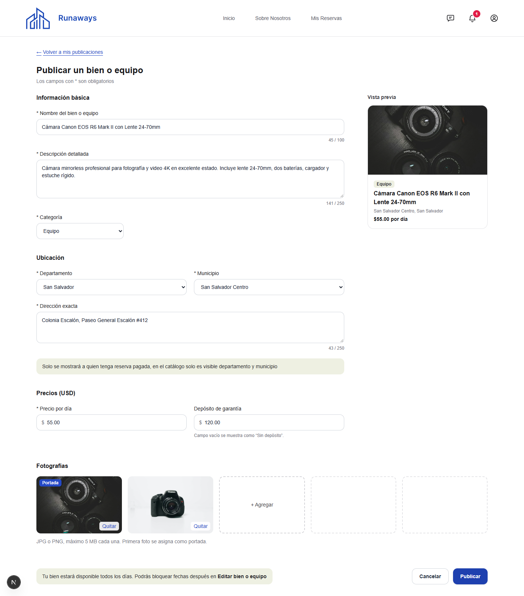

6. Haz clic en **Publicar**. El sistema guarda el bien como disponible, redirige a `/properties/mine?published=1` y muestra el aviso *"Bien publicado exitosamente"*.

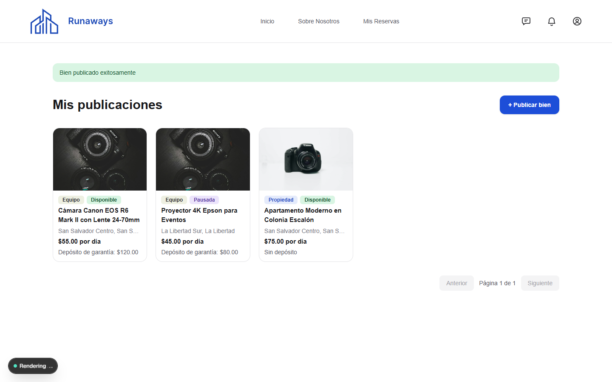

#### Explorar el catálogo de bienes en renta (H2)

1. Inicia sesión con el rol activo **Arrendatario** y accede al **Catálogo** (`/properties`, o mediante *Ver catálogo completo* desde el inicio).
2. Explora el listado de hasta 12 bienes disponibles por página ordenados del más reciente al más antiguo. Cada tarjeta muestra la fotografía de portada, la categoría, el nombre, el municipio y departamento, y el precio por día con dos decimales (por ejemplo, `$55.00 por día`). Los bienes pausados o eliminados no aparecen en el catálogo.

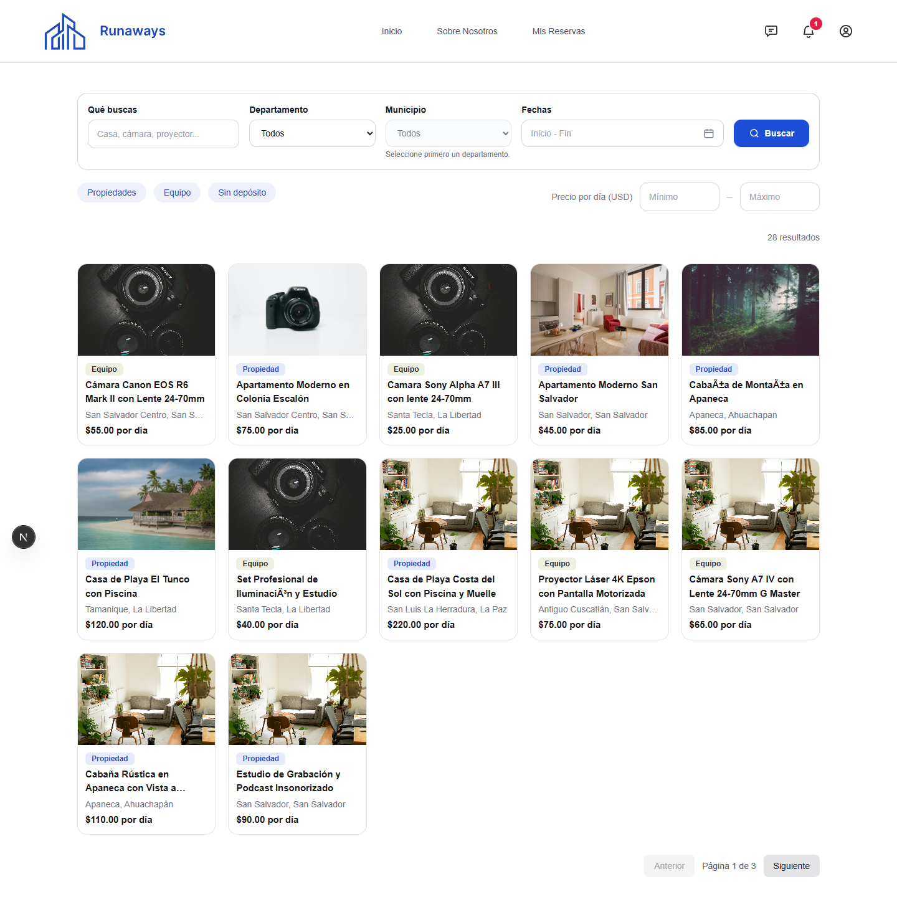

3. Usa los controles **Anterior** y **Siguiente** junto al indicador *Página X de Y* para recorrer las páginas disponibles del catálogo.

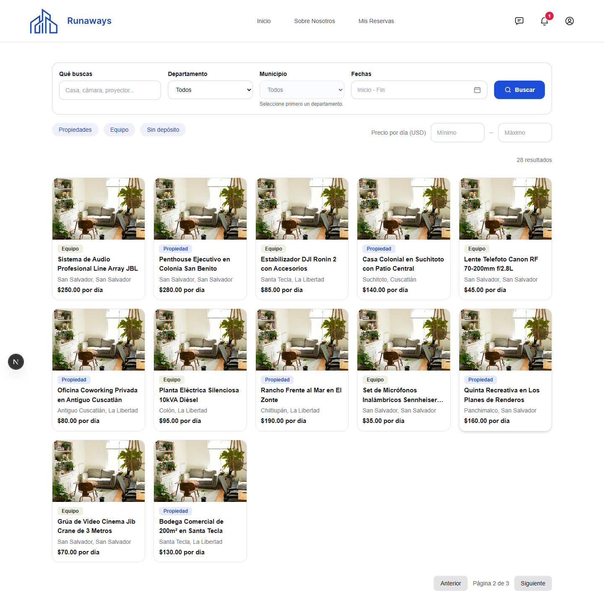

#### Consultar el detalle de un bien (H3)

1. Desde el catálogo, haz clic sobre la tarjeta del bien que deseas revisar para abrir su pantalla de detalle (`/properties/[id]`).
2. Consulta la galería interactiva de fotografías (con botones para cambiar entre imágenes), la categoría, la ubicación, la calificación promedio y número de reseñas (o *"Sin calificaciones"* si aún no tiene), la descripción completa y los datos del arrendador.
3. En el panel lateral derecho revisa el precio por día, el depósito de garantía (o *"Sin depósito"* cuando es `$0.00`), el selector de fechas de disponibilidad (**Selecciona tus fechas**), el botón **Confirmar reserva** (requiere cuenta verificada; de lo contrario bloquea la acción y muestra *"Debes verificar tu cuenta para rentar."*) y el botón **Preguntar al arrendador**. Puedes regresar en cualquier momento con **Volver al catálogo**.

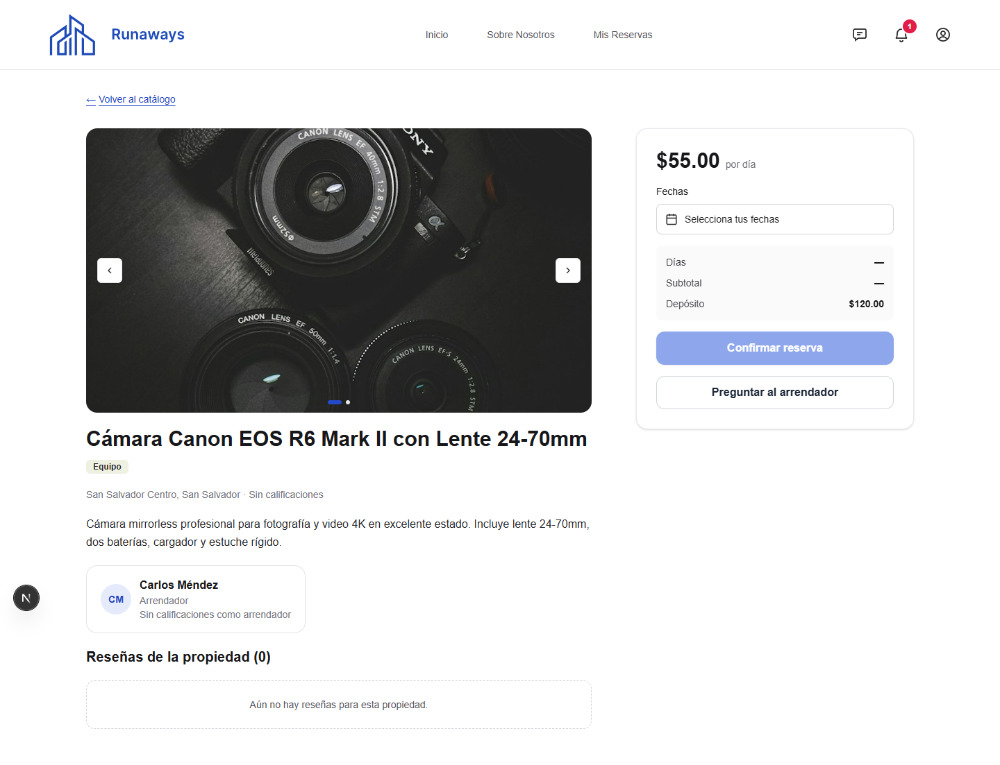

#### Ver mis publicaciones y editar un bien (H4)

1. Con el rol activo **Arrendador**, ingresa a **Mis publicaciones** (`/properties/mine`) para consultar tus bienes en estado **Disponible** o **Pausada** (hasta 12 por página, con paginación y acceso al botón **+ Publicar bien**).

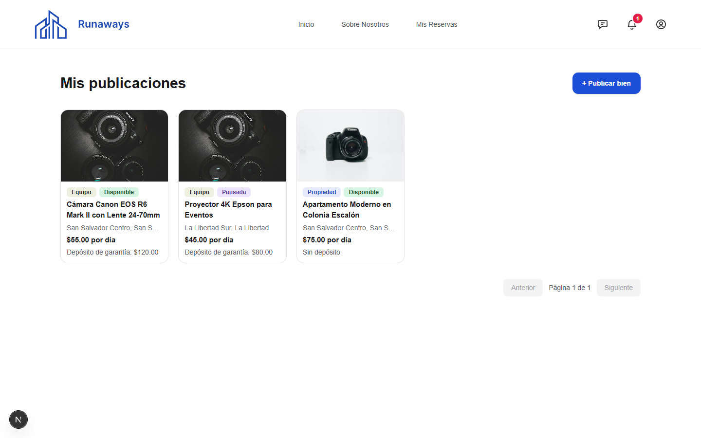

2. Selecciona una publicación para abrir **Editar bien o equipo** (`/properties/[id]/edit`), que se muestra inicialmente en modo de solo lectura.
3. Haz clic en **Editar** para habilitar la modificación de nombre, descripción, categoría, ubicación, precios y fotografías dentro de la misma pantalla. Si deseas deshacer los cambios sin guardar, presiona **Cancelar** para volver al modo de solo lectura con los datos previos.

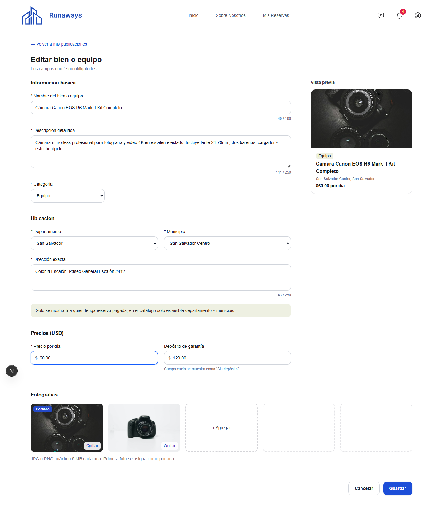

4. Haz clic en **Guardar** para registrar las modificaciones. La vista muestra el mensaje *"Cambios guardados"* y regresa al modo de solo lectura con la información actualizada. Si el bien tiene reservas en estado pendiente o pagada, no se permite modificar el precio por día ni el depósito de garantía, aunque sí el resto de campos.

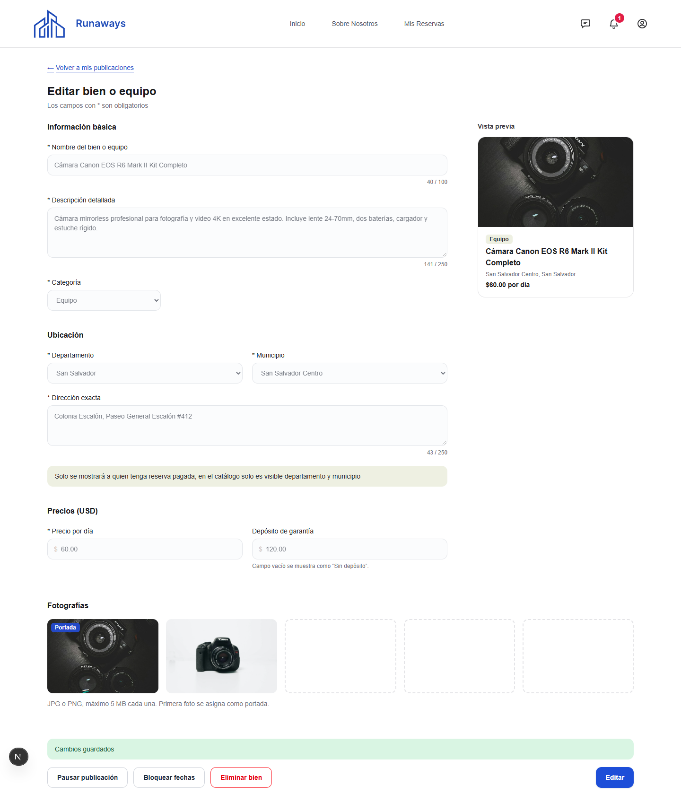

#### Pausar, reactivar y eliminar una publicación (H5)

1. Ingresa a **Editar bien o equipo** (`/properties/[id]/edit`) en modo de solo lectura; en la parte inferior dispones de los botones **Pausar publicación** (o **Reactivar publicación**), **Bloquear fechas** y **Eliminar bien**.
2. Presiona **Pausar publicación** para retirar temporalmente el bien del catálogo y del detalle público; el botón cambiará a **Reactivar publicación** y en **Mis publicaciones** la tarjeta mostrará la etiqueta **Pausada**. Cuando desees volver a mostrarlo en el catálogo, haz clic en **Reactivar publicación**.

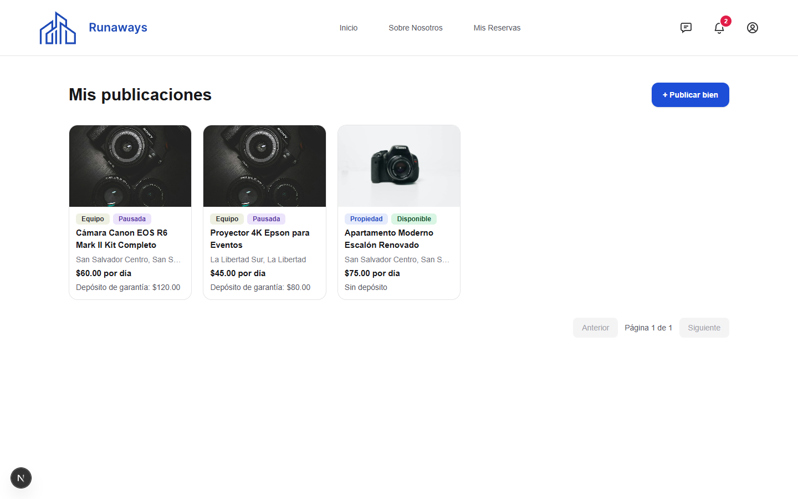

3. Si el bien no tiene reservas activas (pendientes o pagadas) y deseas eliminarlo de forma permanente, presiona **Eliminar bien**. El sistema abrirá la ventana de confirmación *"¿Eliminar «nombre del bien»? Esta acción no se puede deshacer."*.

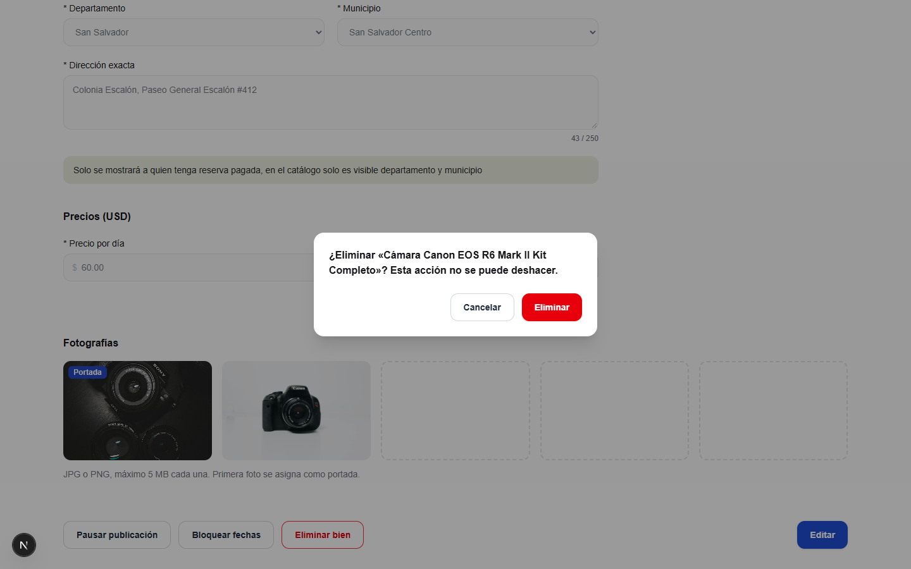

4. Haz clic en **Eliminar** para confirmar (o en **Cancelar** para cerrar el diálogo sin borrar). Al confirmar, la publicación desaparece de **Mis publicaciones**, del catálogo y del detalle público, y regresas a `/properties/mine`.

### Módulo 2: Búsqueda y filtros

#### Búsqueda de bienes por criterios (H6)

1. Inicia sesión con el rol activo **Arrendatario** e ingresa al **Catálogo** (`/properties`). En la parte superior dispones de la barra de búsqueda con los campos **Qué buscas** (entre 2 y 100 caracteres), **Departamento**, **Municipio** (habilitado al elegir un departamento) y los botones de características **Propiedades**, **Equipo** y **Sin depósito**.
2. Ingresa los criterios deseados y presiona **Buscar**. Los resultados se actualizan combinando todos los filtros aplicados (sin distinguir mayúsculas ni tildes y excluyendo bienes pausados o eliminados), reflejan los parámetros en la URL para recargar o compartir y muestran el total encontrado junto con etiquetas activas con botón **×** para quitar cada filtro de inmediato.

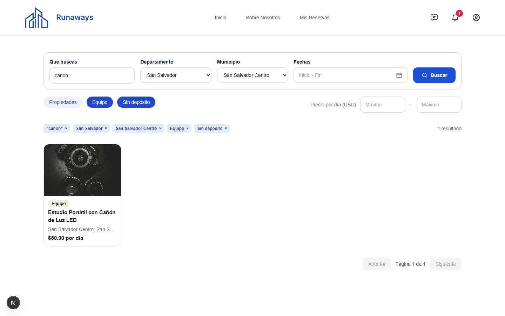

3. Si ningún bien disponible coincide con los filtros aplicados, el sistema muestra el mensaje *"No se encontraron resultados"* y el botón **Limpiar filtros** para restablecer todos los criterios y volver a la página 1 del catálogo.

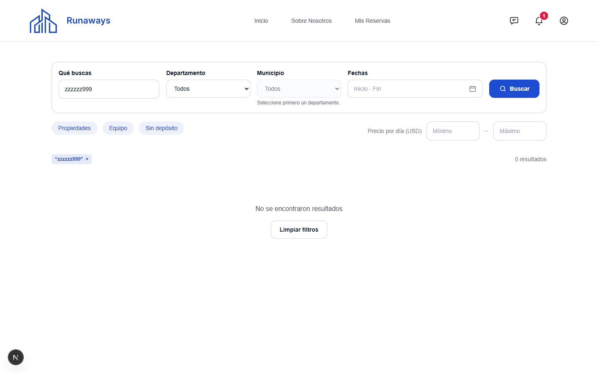

#### Filtrar bienes por rango de precio (H7)

1. En el panel de filtros del **Catálogo** (`/properties`), ubica la sección **Precio por día (USD)** con los campos numéricos **Mínimo** y **Máximo** (valores positivos entre `$0.01` y `$9999.99` con hasta 2 decimales). Puedes ingresar ambos límites, solo el mínimo o solo el máximo.
2. Haz clic en **Buscar** para aplicar el rango de precio junto con los demás criterios activos. El catálogo muestra únicamente los bienes cuyo precio por día se encuentra dentro del rango indicado (incluyendo los valores límite) y agrega la etiqueta correspondiente (*"$30.00 – $50.00"*, *"Desde $..."* o *"Hasta $..."*).

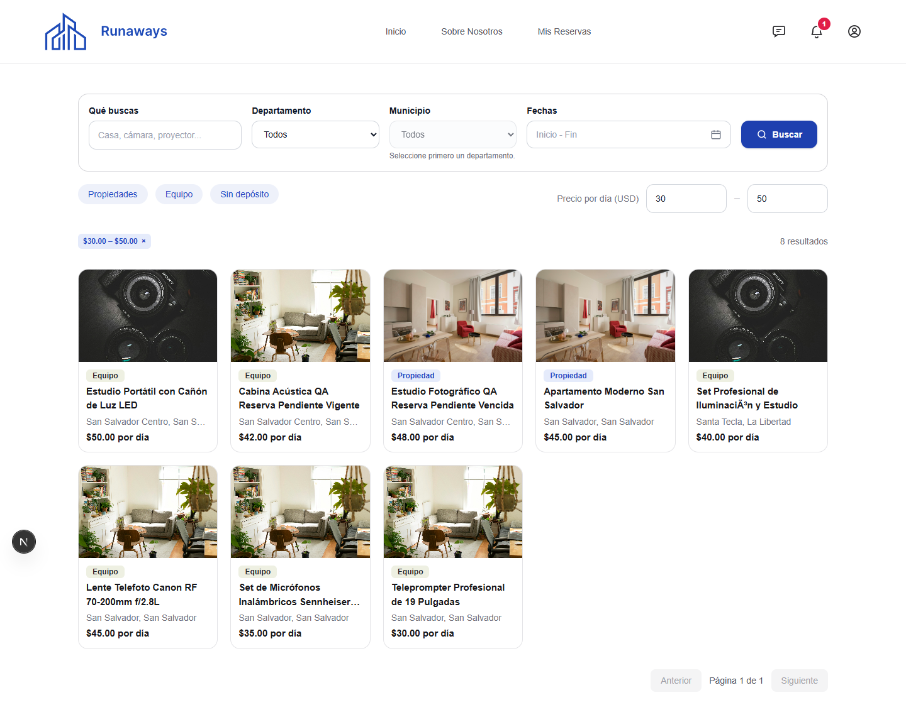

3. Si ingresas un valor menor o igual a `0`, con más de 2 decimales, mayor a `$9999.99`, o un precio mínimo superior al máximo, el sistema muestra el mensaje de validación correspondiente y deshabilita el botón **Buscar** hasta corregir el rango.

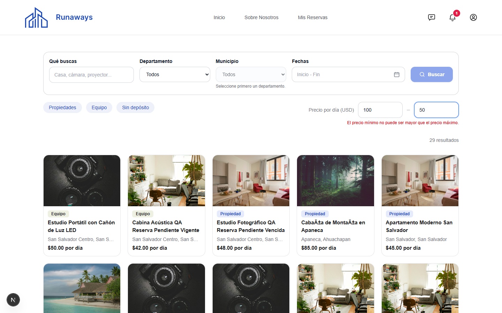

#### Filtrar bienes por disponibilidad de fechas (H8)

1. En la barra de búsqueda del **Catálogo** (`/properties`), haz clic sobre el campo **Fechas** (`Inicio - Fin`) para abrir el selector de calendario, el cual habilita únicamente los días comprendidos entre la fecha actual y los próximos 90 días (`hoy` a `hoy + 89`) con un rango máximo de 30 días.
2. Selecciona la fecha de inicio y la fecha de fin (ambas obligatorias para aplicar el filtro; puedes usar **Limpiar fechas** dentro del selector para reiniciar la selección).

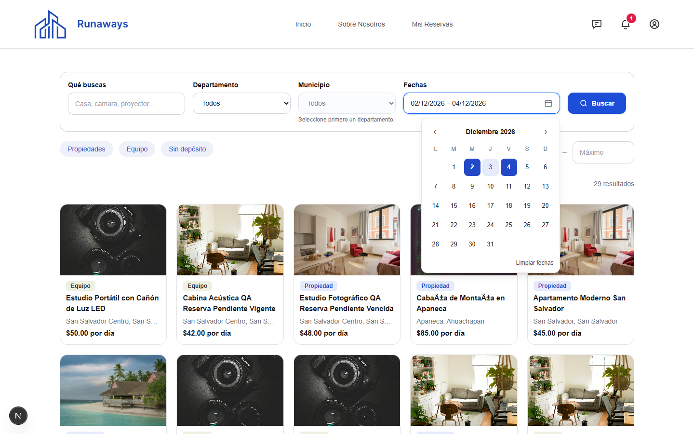

3. Haz clic en **Buscar**. El sistema muestra la etiqueta *"Del DD/MM/AAAA al DD/MM/AAAA"* y excluye las publicaciones que dentro del periodo seleccionado tengan una reserva pagada, una reserva pendiente vigente o un bloqueo del arrendador, conservando disponibles aquellas con reservas canceladas, finalizadas o pendientes vencidas.

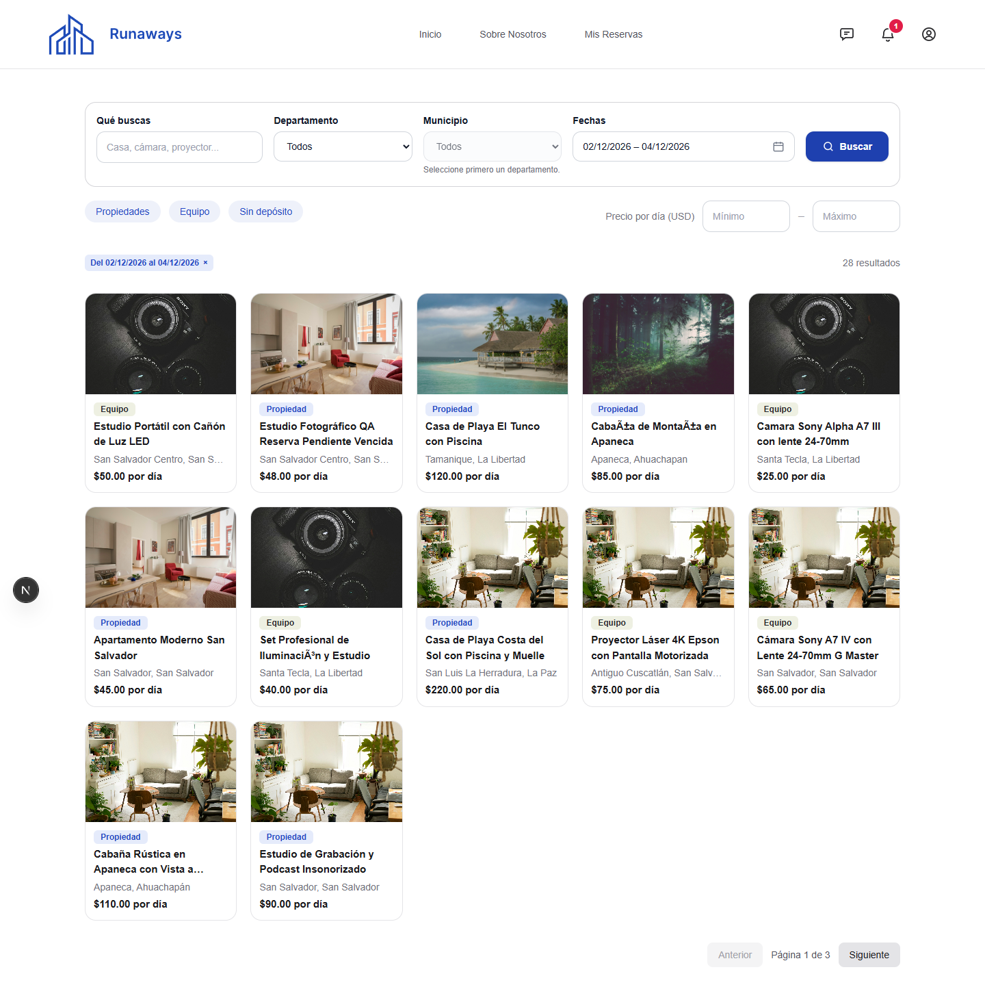

### Módulo 3: Reservas y calendario de disponibilidad

#### Consultar disponibilidad de un bien (H9)

1. Inicia sesión con el rol activo **Arrendatario** e ingresa al detalle de un bien disponible (`/properties/[id]`).
2. En el panel lateral derecho, haz clic sobre **Selecciona tus fechas** para desplegar el calendario de disponibilidad de los próximos 90 días (`hoy` a `hoy + 89`).
3. Revisa la disponibilidad marcada por colores sin mostrar datos de terceros: los días disponibles se muestran en verde (**Libre**), los días con reservas `PENDIENTE`/`PAGADA` o bloqueos del arrendador en gris (**No disponible**), y las fechas anteriores a hoy o posteriores a 90 días permanecen deshabilitadas.

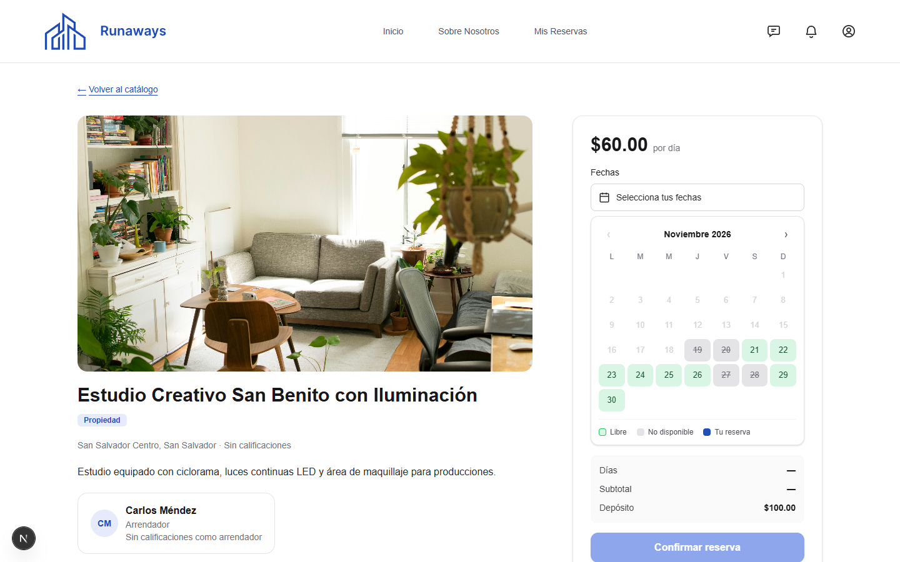

#### Reservar un bien y consultar reservas (H10)

1. Desde el detalle del bien (`/properties/[id]`) como **Arrendatario** con cuenta verificada, selecciona en el calendario la fecha de inicio y la fecha de fin dentro de los días libres (rango máximo de 30 días).
2. Verifica en el resumen del panel derecho la cantidad de **Días** (contando inicio y fin), el **Subtotal** calculado (`precio por día × días`) y el **Depósito** de garantía con dos decimales.

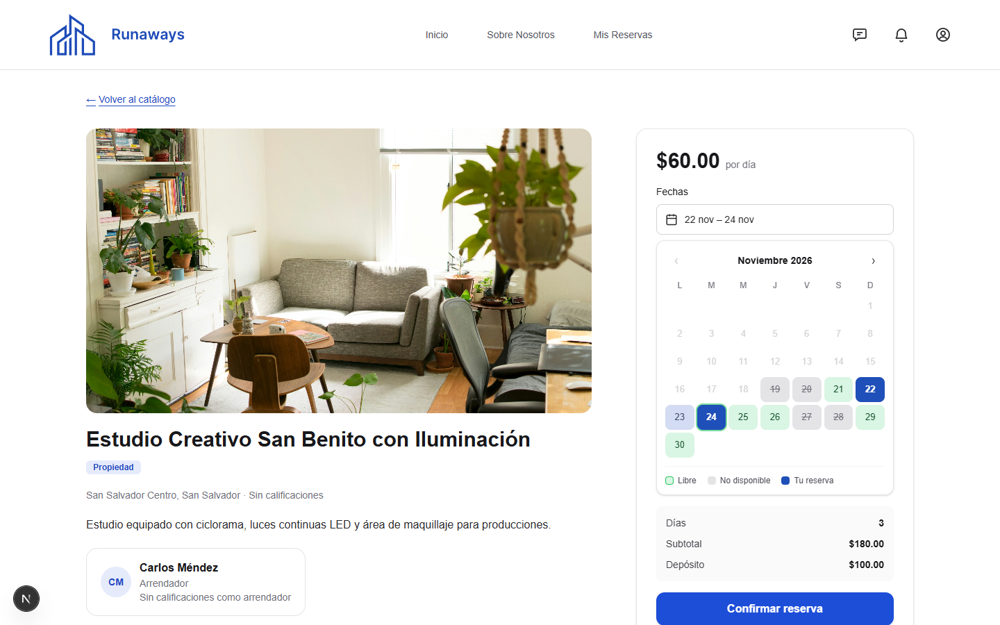

3. Haz clic en **Confirmar reserva**. El sistema crea la reserva en estado `PENDIENTE`, ocupa sus fechas por 24 horas, redirige a **Mis reservas** (`/bookings/mine?created=1`) con el aviso *"Reserva creada. Tienes 24 horas para pagarla."*, muestra la fecha límite en *"Pagar antes de"*, permite filtrar por estado y habilita el botón **Pagar**.

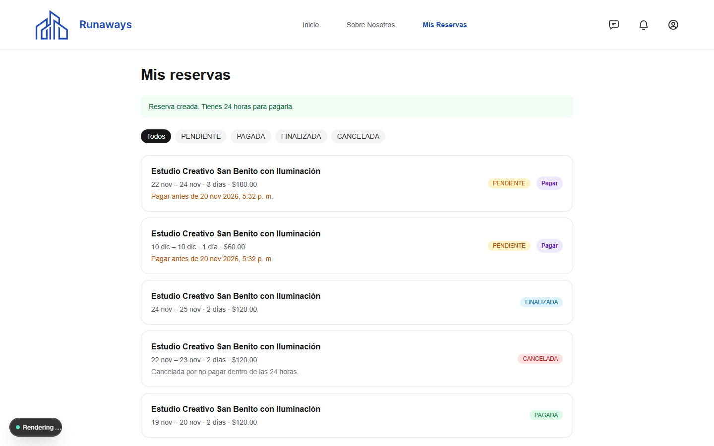

4. Como **Arrendador**, accede a **Reservas de mis bienes** (`/lessor/bookings`) para consultar las reservas registradas sobre tus propiedades, incluyendo el nombre del **Arrendatario**, fechas, subtotal, estado, acceso al depósito y filtros por estado.

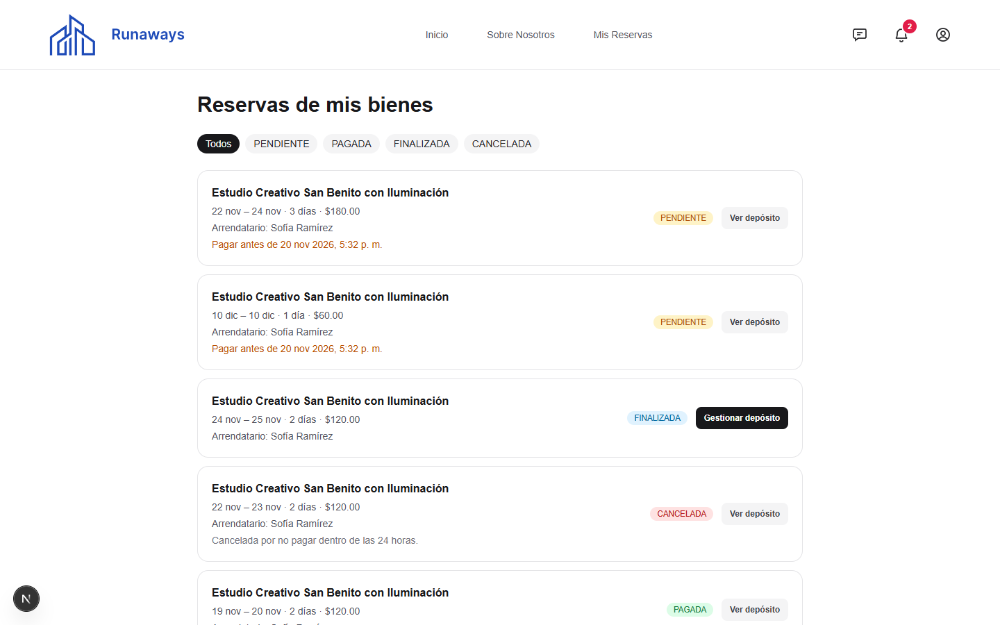

#### Bloquear y eliminar fechas no disponibles (H12)

1. Con el rol activo **Arrendador**, ingresa a **Editar bien o equipo** (`/properties/[id]/edit`) y presiona **Bloquear fechas** para abrir **Gestionar disponibilidad** (`/properties/[id]/availability`).
2. En el calendario izquierdo selecciona la fecha de inicio y la fecha de fin (dentro de los próximos 90 días y sin traslaparse con bloqueos ni reservas `PENDIENTE` o `PAGADA`) y haz clic en **Bloquear fechas**. El sistema muestra *"Fechas bloqueadas."*, agrega el rango a la tabla **Bloqueos** (donde solo se listan bloqueos vigentes ordenados por inicio) y marca esos días como ocupados en el calendario de disponibilidad.

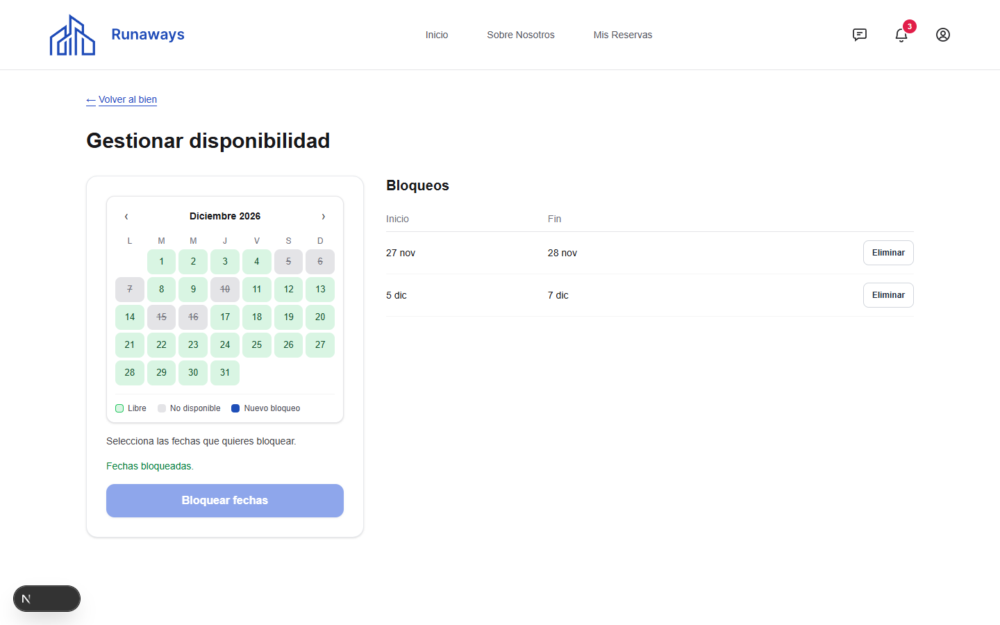

3. Para liberar un bloqueo vigente, presiona **Eliminar** en la fila correspondiente de la tabla **Bloqueos** y confirma el mensaje *"¿Eliminar el bloqueo ...?"* haciendo clic en **Confirmar** (o **Cancelar** para conservarlo). El sistema muestra *"Bloqueo eliminado."* y vuelve a dejar esos días libres si no tienen reservas activas.

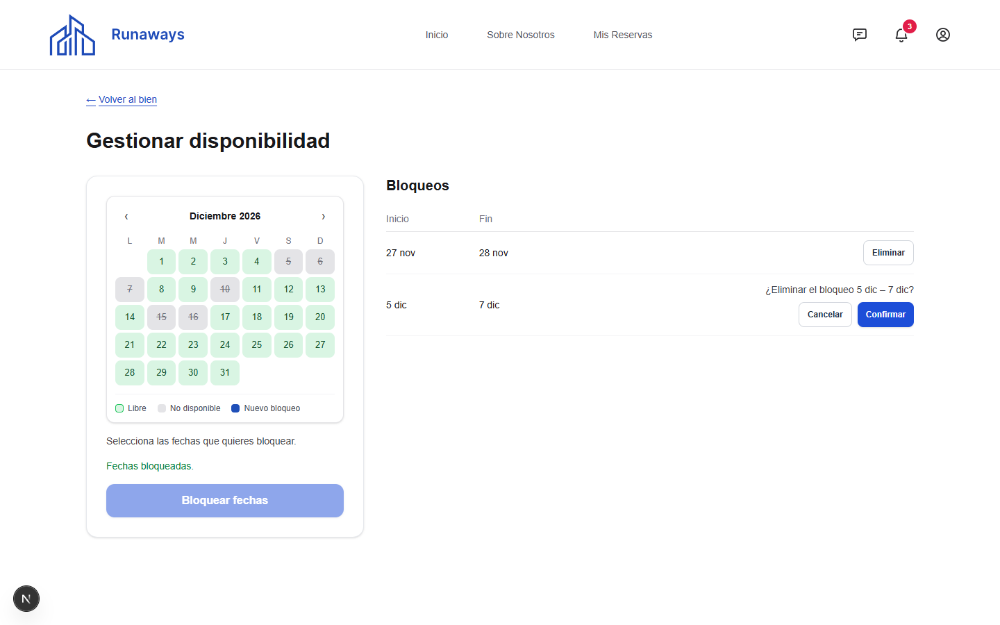

### Módulo 4: Pagos y depósitos de garantía

#### Pago de alquiler con detalle del depósito (H13)

1. Inicia sesión con el rol activo **Arrendatario** e ingresa a **Mis reservas** (`/bookings/mine`); en la reserva en estado `PENDIENTE` haz clic en **Pagar** (o accede directamente a `/bookings/[id]/payment`, que redirige a `/payment?reservationId=...`).
2. Revisa en **Resumen de la reserva** el título del bien, la fecha de renta, la cantidad de días, el subtotal de alquiler, el depósito de garantía, el **Total a pagar** (`subtotal + depósito` con dos decimales) y el aviso de hora límite en *"Pagar antes de:"*.
3. Completa el formulario **Método de pago** con el **Nombre del titular** (mínimo 3 caracteres), **Número de tarjeta** (16 dígitos), **Vencimiento** (`MM/YY` vigente) y **CVC** (3 o 4 dígitos) y presiona **Pagar ahora** (o **Cancelar** para volver atrás).

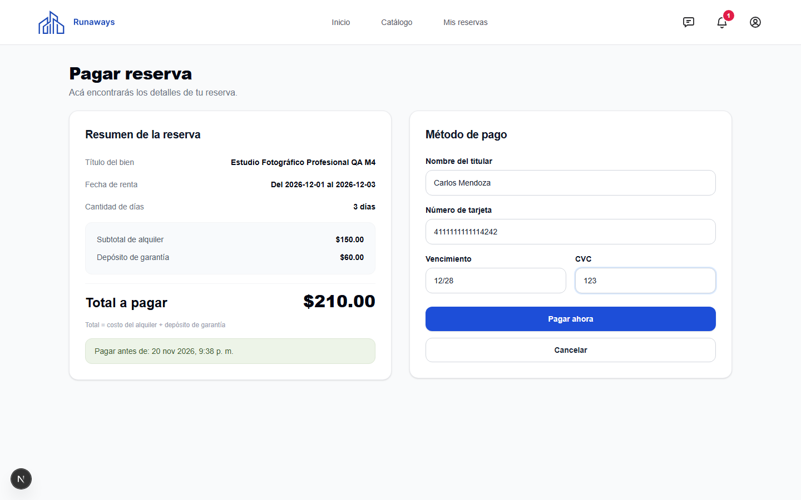

4. La pasarela simulada procesa el pago durante 2 segundos: si la tarjeta termina en `0002`, muestra *"Fondos insuficientes. Intenta con otra tarjeta"* y mantiene la reserva en `PENDIENTE`; cualquier otra tarjeta distinta de `4242` muestra *"Tarjeta no válida"*, sin enviar solicitud de cobro al servidor.

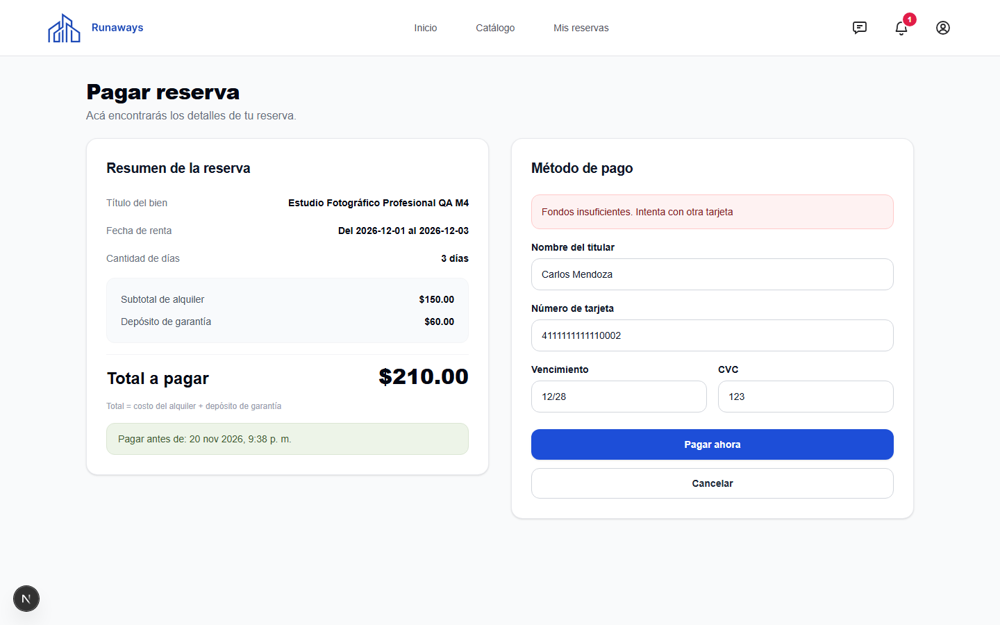

5. Al pagar con una tarjeta terminada en `4242`, el sistema registra el cobro, cambia la reserva a `PAGADA`, notifica al arrendador y redirige a **Historial de movimientos y recibos de pago** (`/receipt?...`), donde puedes consultar la tabla **Movimientos** (`Fecha`, `Tipo`, `Monto`, `Motivo` y acción **Ver recibo**) y la tarjeta **Recibo de pago de reserva** con el estado `Pagada`, el **N.º de transacción** (`PAY-...`), fecha y hora de pago, desglose de subtotal, depósito y **Total pagado**, y los últimos 4 dígitos de la tarjeta.

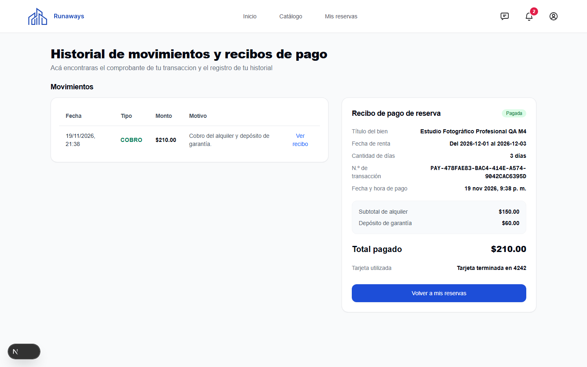

#### Devolución o retención del depósito de garantía (H14)

1. Inicia sesión con el rol activo **Arrendador** y abre la gestión del depósito de una reserva con depósito mayor a cero en `/bookings/[id]/deposit` (redirige a `/deposit?reservationId=...`; el arrendatario también puede consultar esta ruta para revisar el estado y los movimientos de su reserva).
2. En **Información del pedido**, revisa el estado de la reserva (`Finalizada`), el título del bien, el período de renta, el **Monto en garantía**, el **Estado** del depósito (`Pendiente de decisión`), la **Fecha límite para decidir**, el **Historial de movimientos de la reserva** en la parte inferior y, cuando la reserva está finalizada y pendiente de decisión, los botones **Devolver depósito** y **Retener depósito** (si la reserva aún no está finalizada, se ocultarán ambos botones).

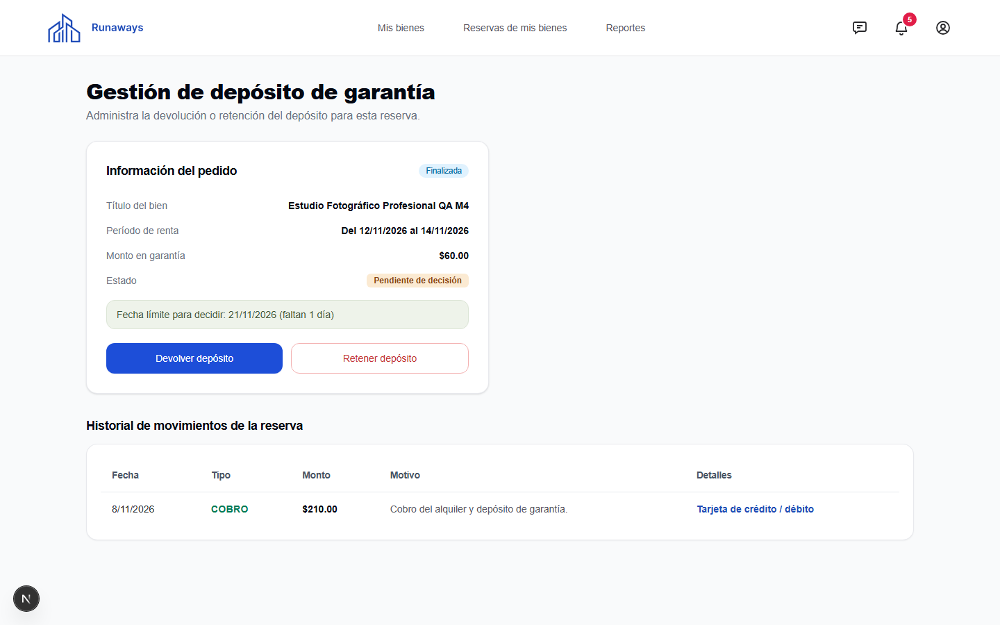

3. Para devolver la totalidad del depósito, haz clic en **Devolver depósito**; se abrirá el diálogo de confirmación *"¿Devolver depósito de garantía?"* con el monto total en garantía.

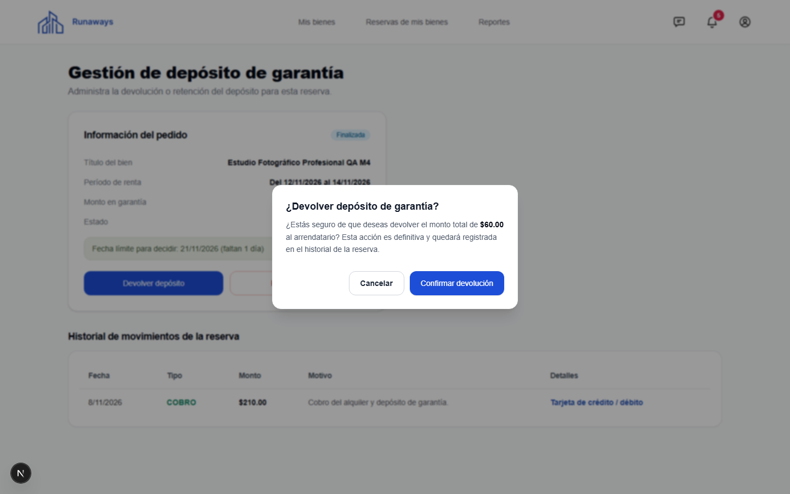

4. Presiona **Confirmar devolución** (o **Cancelar** para cerrar el diálogo). El sistema registra la devolución completa, cambia el estado a **Devuelto**, agrega el movimiento **DEVOLUCIÓN** en el historial y notifica al arrendatario.
5. Para retener todo o parte del depósito, haz clic en **Retener depósito** para abrir el formulario **Retener depósito de garantía**, ingresa el **Monto por retener (USD)** (mayor a `0` y menor o igual al depósito; si es menor, se muestra el cálculo de la diferencia que se devolverá automáticamente) y escribe el **Motivo de la retención** (mínimo 10 y máximo 250 caracteres).

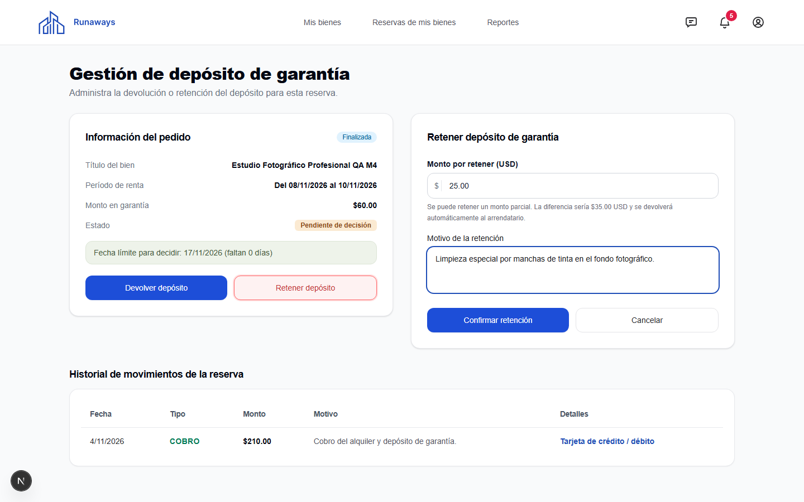

6. Haz clic en **Confirmar retención**. El depósito pasa a **Retenido** (si retienes el total) o **Retenido parcialmente** (si retienes una fracción), se registran en el **Historial de movimientos de la reserva** el movimiento **RETENCIÓN** con el motivo indicado y el movimiento **DEVOLUCIÓN** por la diferencia restante (cuando aplique), y el sistema notifica al arrendatario. Si transcurren 7 días calendario sin decisión tras finalizar la reserva, el sistema devuelve el depósito automáticamente con el motivo *"Plazo de decisión vencido"*.

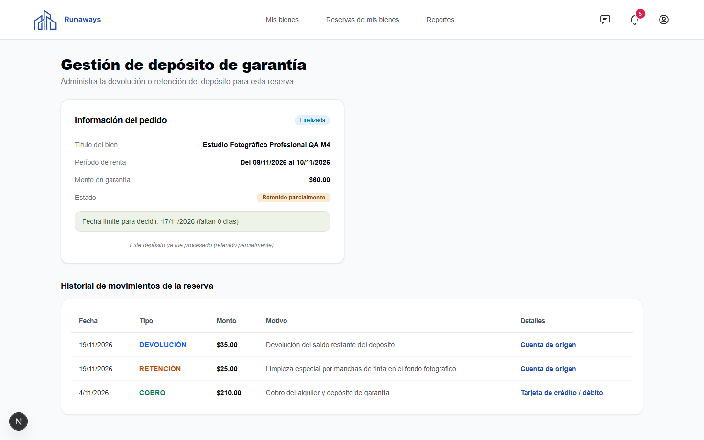

### Módulo 5: Mensajería entre arrendador y arrendatario

#### Preguntar dudas sobre el alquiler (H15)

1. Inicia sesión con el rol activo **Arrendatario** y abre el detalle de un bien (`/properties/[id]`) que deseas rentar.
2. Haz clic en **Preguntar al arrendador** para iniciar o abrir el hilo de conversación asociado al bien. Si ya existe una conversación para ese bien y esos participantes, continúa en el mismo hilo.

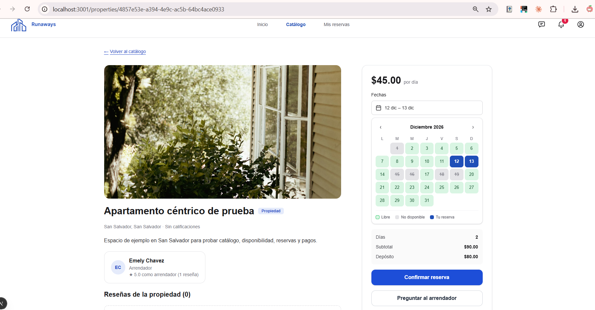

3. En el hilo, escribe tu duda o los detalles que deseas coordinar en el campo de mensaje (de 1 a 500 caracteres) y presiona **Enviar**. El mensaje queda asociado a la conversación del bien y el arrendador puede consultarlo desde **Mensajes** (`/messages`).

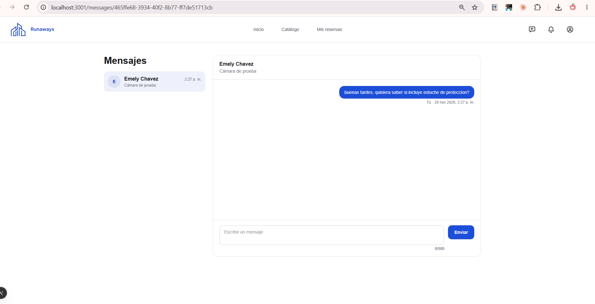

#### Responder y coordinar la entrega del bien (H16)

1. Con el rol activo **Arrendador**, ingresa a **Mensajes** (`/messages`) y abre la conversación del bien para el que deseas coordinar la entrega. La lista permite identificar conversaciones con mensajes no leídos.

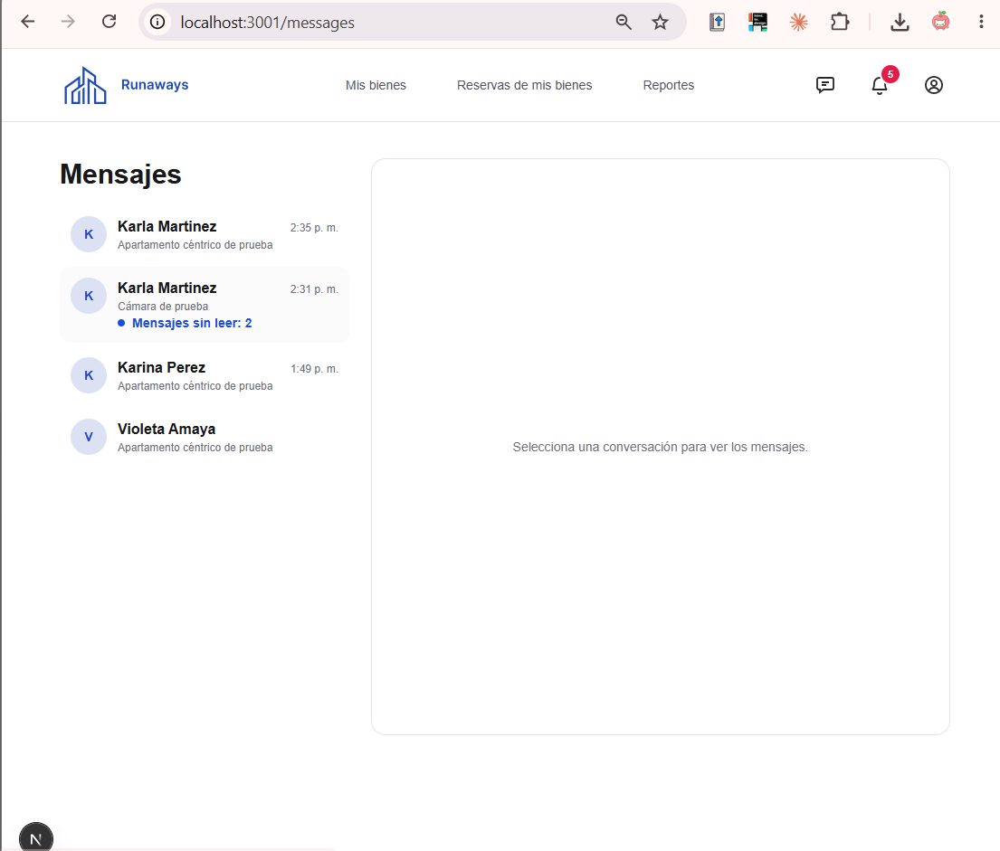

2. Lee el mensaje del arrendatario en el hilo (`/messages/[conversationId]`) y responde desde el campo de mensaje. Escribe entre 1 y 500 caracteres y presiona **Enviar** para acordar los detalles de entrega.

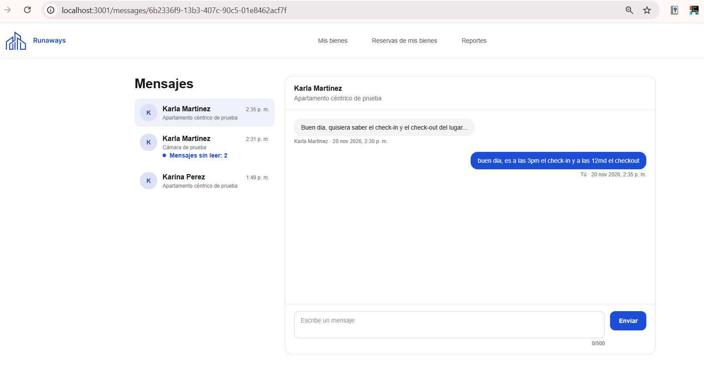

3. El arrendatario puede volver a **Mensajes** (`/messages`) y abrir ese mismo hilo para leer la respuesta y continuar la coordinación. La conversación está disponible para sus participantes.

### Módulo 6: Reseñas y calificaciones

#### Calificar la experiencia sobre un bien y su arrendador (H17)

1. Inicia sesión con el rol activo **Arrendatario** e ingresa a **Mis reservas** (`/bookings/mine`). En una reserva `FINALIZADA` que todavía no hayas calificado y cuyo plazo siga vigente, haz clic en **Calificar** para abrir **Calificación de mi reserva** (`/reservations/[id]/rate-property`). El plazo para calificar es de 14 días después de la finalización o del último día de renta.

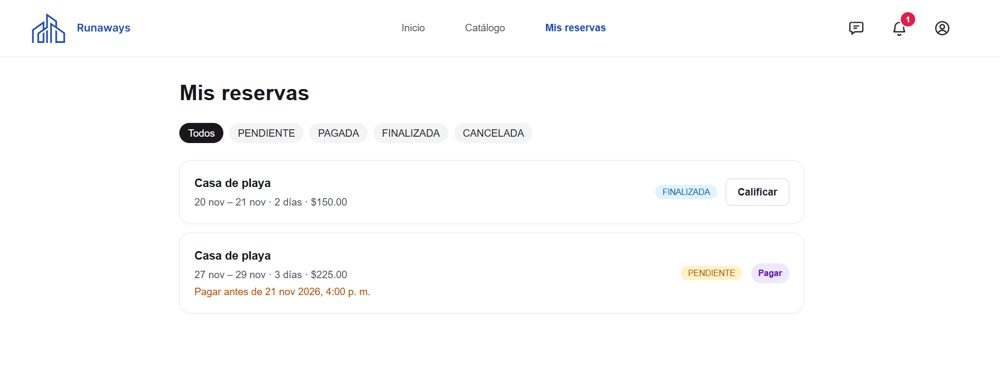

2. Revisa el resumen de la reserva y selecciona una puntuación de 1 a 5 estrellas para **Calificación de la propiedad** y otra para **Calificación del arrendador**. Si deseas, agrega un comentario de hasta 200 caracteres; el contador indica los caracteres ingresados.

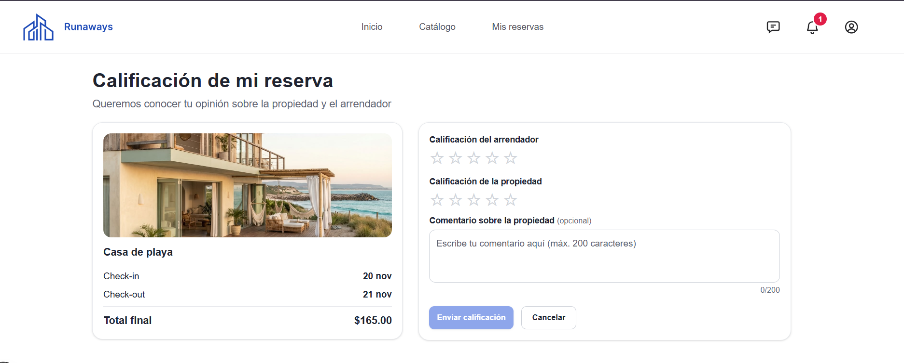

3. Presiona **Enviar calificación** y confirma en el diálogo **¿Enviar calificación?**. La calificación no se puede modificar después de enviarla. Al completarse, el sistema muestra *"Calificación enviada"* en **Mis reservas**.

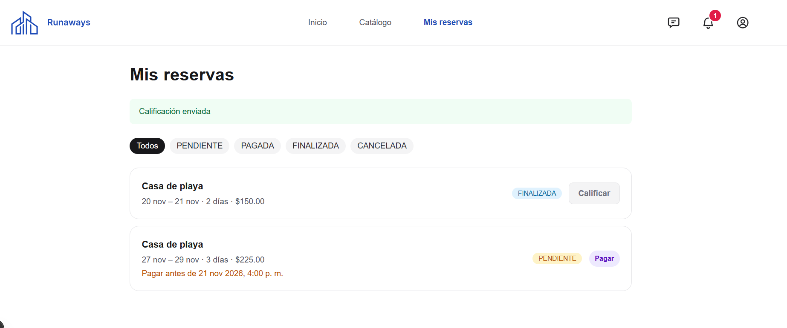

#### Calificar la experiencia con un arrendatario (H18)

1. Inicia sesión con el rol activo **Arrendador** y abre **Reservas de mis bienes** (`/lessor/bookings`). En una reserva `FINALIZADA` que aún no hayas calificado, haz clic en **Calificar** en la columna **Reseña** para ir a `/reservations/[id]/rate-renter`.

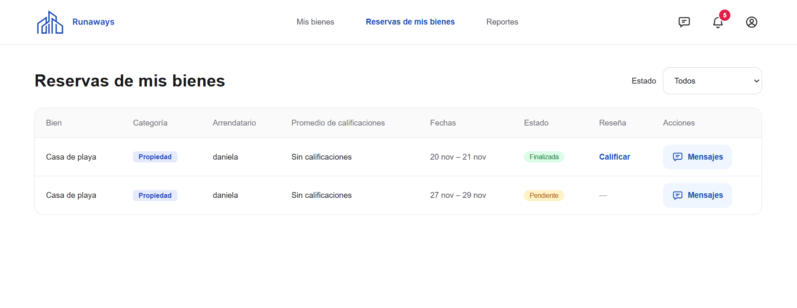

2. Selecciona de 1 a 5 estrellas para **Calificación del arrendatario**. Opcionalmente, escribe un comentario de hasta 200 caracteres y revisa el contador.

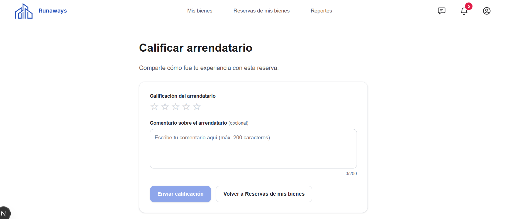

3. Presiona **Enviar calificación** y confirma el envío en el diálogo. Una vez enviada, no podrás modificarla; el sistema guarda la calificación y regresa a **Reservas de mis bienes**. Para H17, si la reserva no está finalizada, ya fue calificada o terminó el plazo de 14 días, el sistema informa el motivo y ofrece volver a **Mis reservas**.

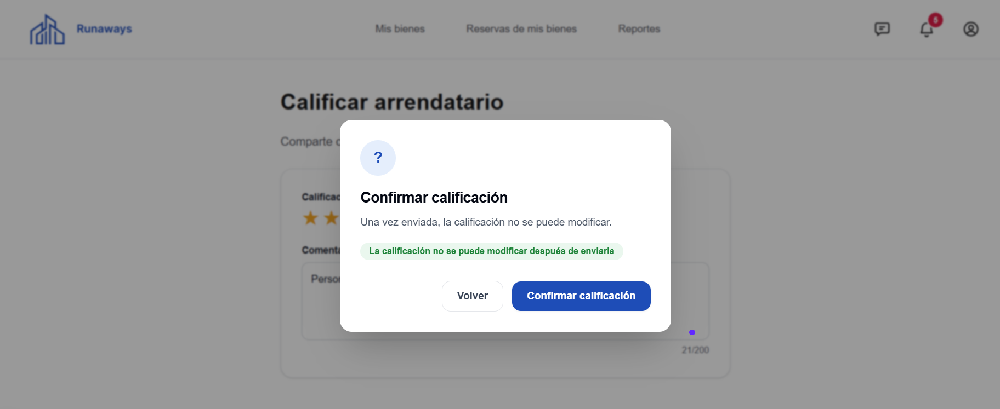

### Módulo 7: Verificación de identidad

#### Subir documento de identidad (H19)

1. Inicia sesión e ingresa a **Verificar mi cuenta** desde tu perfil (`/profile/verification`).
2. Selecciona el **Tipo de documento** (**DUI** o **Pasaporte**) e ingresa el **Número de documento**: el DUI usa el formato `00000000-0` y el pasaporte lleva de 6 a 15 letras o números.
3. Arrastra o selecciona el archivo del documento: un solo archivo **JPG**, **PNG** o **PDF** de máximo 5 MB. Antes de enviar se muestra la vista previa de la imagen, o el nombre del archivo si es un PDF. El sistema no permite enviar un archivo con otro formato, uno mayor a 5 MB ni un número con el formato incorrecto.

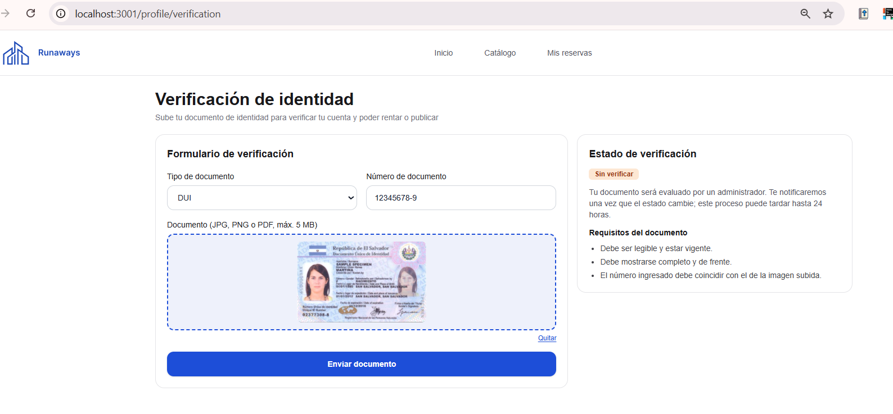

4. Haz clic en **Enviar**. El sistema muestra *"Documento enviado. Te avisaremos cuando sea revisado."* y el estado de tu cuenta cambia a **Pendiente**. Mientras el documento está pendiente, o si tu cuenta ya está verificada, no se permite enviar otro.

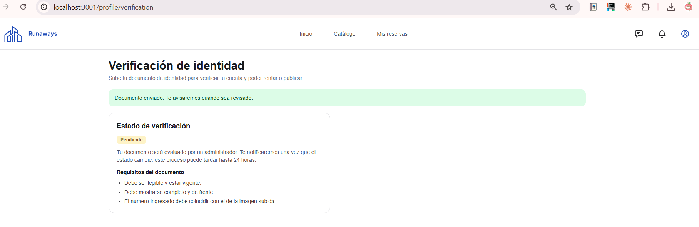

5. Si el administrador rechaza el documento, la pantalla muestra el motivo del rechazo y el botón **Subir nuevo documento** para volver a intentarlo.

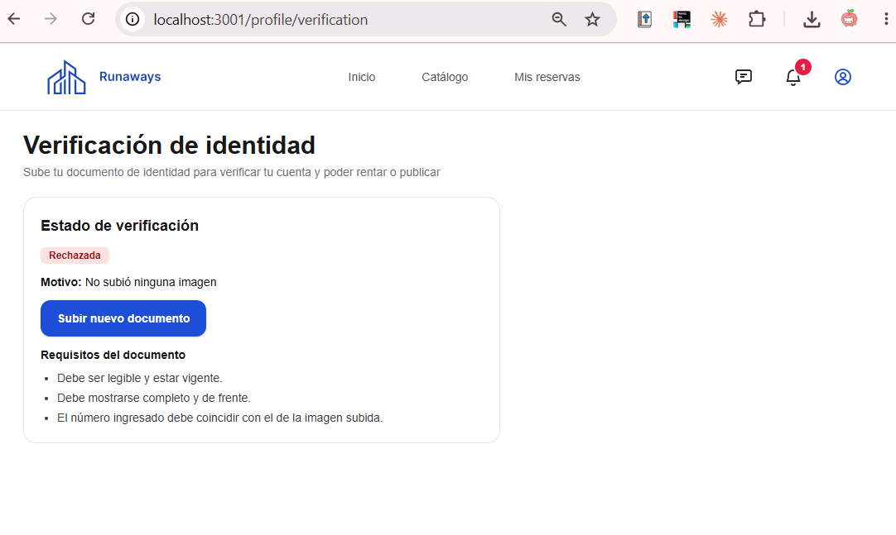

#### Revisión y aprobación de documentos (H20)

1. Inicia sesión con el rol **Administrador** e ingresa a **Verificaciones** (`/admin/verifications`). La lista muestra los documentos pendientes del más antiguo al más reciente (10 por página), con el usuario (nombre y correo), el tipo, el número, la fecha de envío y el botón **Revisar**. Si no hay documentos, muestra *"No hay documentos pendientes de revisión."*.

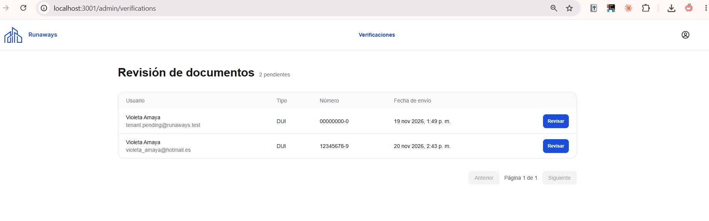

2. Haz clic en **Revisar** para abrir la pantalla de revisión (`/admin/verifications/[userId]`), que muestra los datos del usuario, el archivo del documento (imagen o PDF) y los botones **Aprobar** y **Rechazar**.

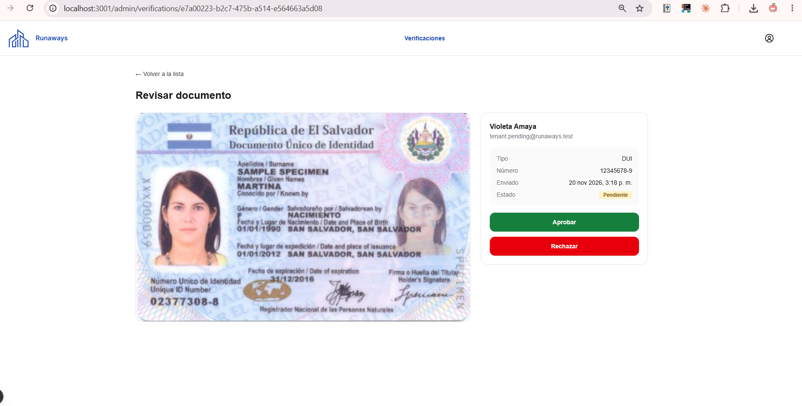

3. Para aprobar, haz clic en **Aprobar**. El sistema muestra *"Documento aprobado."*, la cuenta del usuario queda verificada y el documento sale de la lista.
4. Para rechazar, haz clic en **Rechazar** y escribe el motivo (de 10 a 300 caracteres); el botón **Confirmar rechazo** se habilita solo cuando el motivo cumple ese largo. Al confirmar, el sistema muestra *"Documento rechazado."*, guarda el motivo y el documento sale de la lista. En ambos casos el usuario recibe una notificación con el resultado.

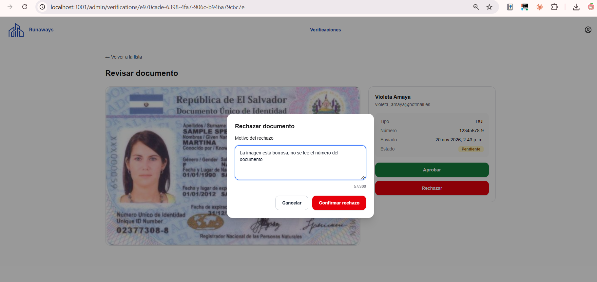

#### Rentar solo a usuarios verificados (H21)

1. Un **Arrendatario** sin cuenta verificada puede ver el catálogo, el detalle de los bienes y su disponibilidad. Al intentar confirmar una reserva, el sistema no lo deja continuar y muestra *"Debes verificar tu cuenta para rentar."* con el acceso **Verificar mi cuenta**, que lleva a `/profile/verification`.

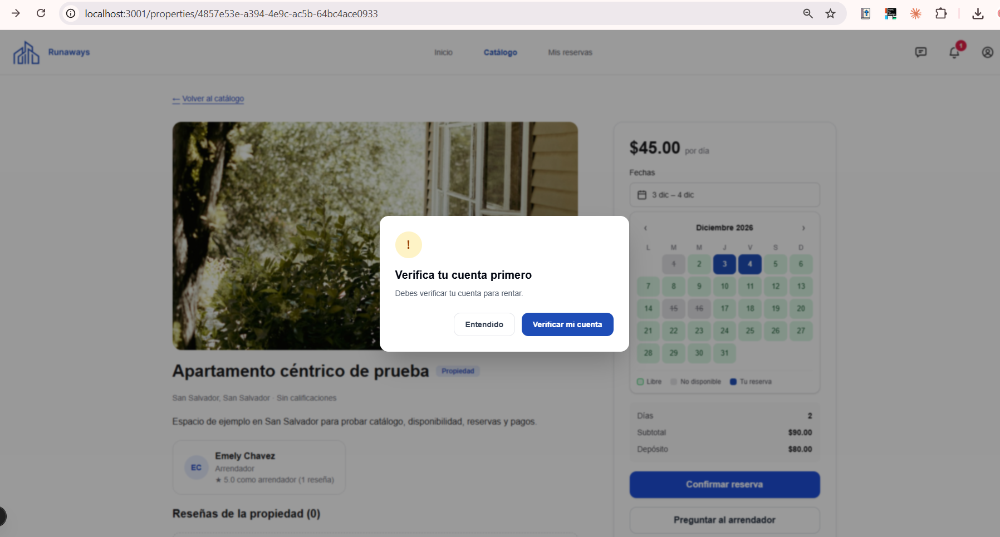

2. Un **Arrendatario** con la cuenta verificada reserva normalmente, sin ver ese mensaje. La regla aplica a todos los bienes de la plataforma y la valida el servidor al crear la reserva y al pagarla.

### Módulo 8: Notificaciones

#### Servicio de emisión de notificaciones (H22)

H22 no tiene una pantalla propia: es el servicio interno del backend que genera una notificación cada vez que ocurre un evento importante en otro módulo. Cada notificación indica su módulo de origen y se guarda para el usuario que la recibe, que la consulta en su bandeja (H23). Algunos de los eventos que generan notificaciones son:

| Evento | Quién la recibe | Título de la notificación |
|---|---|---|
| Nueva reserva de un bien | Arrendador | *"Nueva solicitud de reserva"* |
| Pago de una reserva | Arrendador | *"Pago de reserva confirmado"* |
| Reserva cancelada por falta de pago en 24 horas | Arrendatario y arrendador | *"Reserva cancelada"* |
| Nuevo mensaje en un hilo | La otra persona del hilo | *"Nuevo mensaje recibido"* |
| Decisión sobre el depósito | Arrendatario | *"Depósito de garantía devuelto"* o *"Depósito de garantía retenido"* |
| Revisión del documento de identidad | Usuario que lo envió | *"Documento aprobado"* o *"Documento rechazado"* |

#### Consultar e interactuar con la bandeja de notificaciones (H23)

1. Inicia sesión con cualquier rol. En la barra superior, el ícono de la **campana** muestra un contador con la cantidad de notificaciones sin leer (hasta *"99+"*). El contador se actualiza automáticamente cada 30 segundos y al volver a la pestaña.

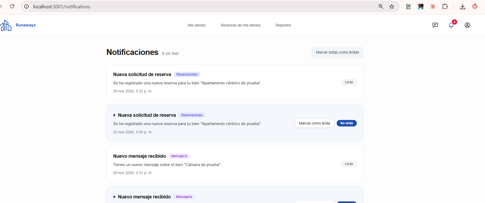

2. Haz clic en la **campana** para abrir **Notificaciones** (`/notifications`). La bandeja muestra las notificaciones de la más reciente a la más antigua (10 por página), cada una con su título, su categoría (**Mensajería**, **Reservaciones**, **Pagos** o **Verificación**), el mensaje, la fecha y su estado **No leída** o **Leída**. En la parte superior se indica cuántas están sin leer.

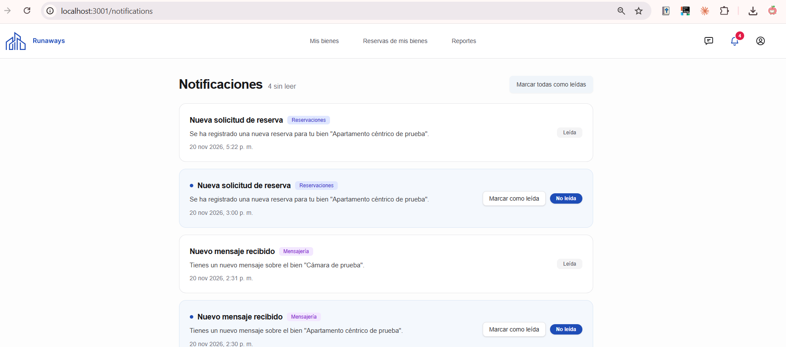

3. Para marcar una notificación como leída, haz clic en **Marcar como leída** en su tarjeta: su estado cambia a **Leída** y el contador de la campana disminuye. Para marcar todas a la vez, haz clic en **Marcar todas como leídas**.

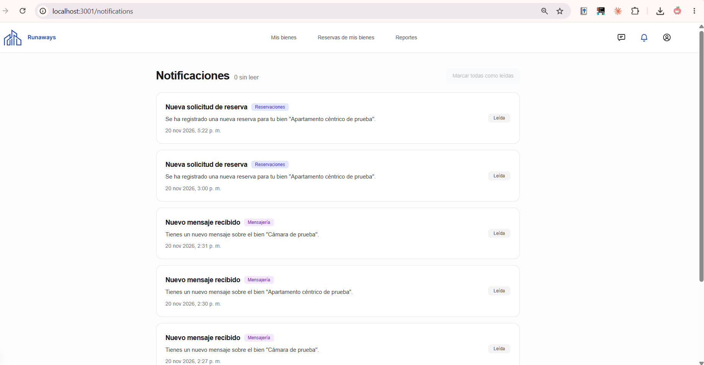

4. Si no tienes notificaciones, la bandeja muestra *"No tienes notificaciones"*. Usa **Anterior** y **Siguiente** para recorrer las páginas cuando tengas más de 10.

### Módulo 9: Panel de reportes para el arrendador

#### Visualización de ingresos totales (H24)

1. Inicia sesión con el rol activo **Arrendador** y haz clic en **Reportes** en la barra de navegación superior (`/owner/reports`).
2. En el filtro de fechas superior, haz clic sobre **Desde** y **Hasta** para seleccionar el período deseado en el calendario (opcionalmente usa el botón **×** de cada campo para borrarlo) y presiona **Aplicar**.
3. Revisa la tarjeta **Ingresos totales**, que muestra el monto acumulado del período en USD con dos decimales y su desglose entre **Alquileres** (reservas en estado `PAGADA` y `FINALIZADA` filtradas por fecha de pago) y **Depósitos retenidos** (depósitos `RETENIDO` o `RETENIDO_PARCIAL` filtrados por fecha de decisión; los depósitos pendientes o devueltos y las reservas pendientes o canceladas no suman). Cuando no existen ingresos en el rango o al pulsar **Limpiar**, la tarjeta muestra `$0.00`.

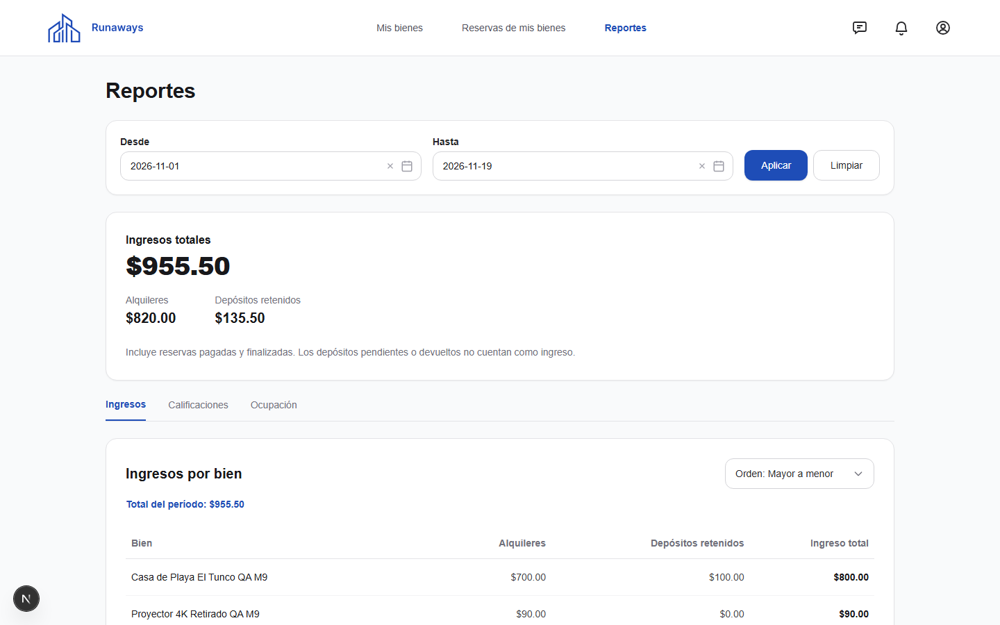

4. Si seleccionas una fecha **Hasta** anterior a **Desde**, el panel marca el campo en rojo, muestra el mensaje *"La fecha final no puede ser anterior a la inicial."* y deshabilita el botón **Aplicar** hasta corregir el rango.

#### Visualización de ingresos por bien publicado (H25)

1. En la pestaña **Ingresos** (`/owner/reports`) con un período aplicado, desplázate hacia la sección **Ingresos por bien**.
2. En la parte superior se muestra **Total del período**, cuyo monto coincide con el de la tarjeta **Ingresos totales**, junto con el selector **Orden** (`Orden: Mayor a menor` por defecto o `Orden: Menor a mayor`).
3. Consulta en la tabla el detalle de cada publicación propia (`Bien`, `Alquileres`, `Depósitos retenidos` e `Ingreso total` en USD a dos decimales, 10 filas por página) sin incluir reservas canceladas y mostrando `$0.00` en los bienes sin ingresos. Usa **Anterior** y **Siguiente** junto al indicador *Página X de Y* para recorrer todas tus publicaciones.

#### Visualización de calificación de los bienes (H26)

1. Desde el submenú de **Reportes**, selecciona la pestaña **Calificaciones** (`/owner/reports/ratings`).
2. Consulta la tabla de solo lectura **Calificación de los bienes** (10 bienes por página), donde cada fila muestra el nombre del **Bien**, su etiqueta de **Estado** (`Disponible`, `Pausado` o `Eliminado`) y la **Calificación promedio** con un decimal y cantidad de reseñas (por ejemplo, `4.5 (2 reseñas)`), o *"Sin calificaciones"* cuando aún no recibe evaluaciones.
3. Cambia el selector entre **Orden: Mayor a menor** y **Orden: Menor a mayor** para reordenar los bienes evaluados (conservando al final los que no tienen calificaciones), navega con **Anterior** / **Siguiente** o haz clic en **Actualizar** para recargar en línea los promedios tras nuevas reseñas sin botones para editar ni eliminar calificaciones.

#### Visualización de la tasa de ocupación por bien (H27)

1. En el submenú de **Reportes**, selecciona la pestaña **Ocupación** (`/owner/reports/occupancy`). Si no seleccionas fechas, el sistema calcula automáticamente los últimos 30 días contando hoy; para evaluar otro intervalo, elige **Desde** y **Hasta** (hasta un máximo de 365 días) y presiona **Aplicar**.
2. Verifica en el encabezado de **Tasa de ocupación** el texto *Período aplicado* y revisa en la tabla cada bien con su **Estado**, **Días ocupados** (solo reservas `PAGADA` o `FINALIZADA` recortadas al período, sin sumar bloqueos del arrendador ni reservas pendientes o canceladas), **Días del período** y **Tasa de ocupación** con un decimal (mostrando `0.0 %` cuando no hubo ocupación). Puedes reordenar con **Orden: Mayor a menor** / **Orden: Menor a mayor**, recargar con **Actualizar** o usar **Anterior** / **Siguiente**.

3. Si el intervalo elegido supera los 365 días o tiene **Hasta** anterior a **Desde**, el sistema muestra *"El período no puede superar 365 días."* (o *"La fecha final no puede ser anterior a la inicial."*) y deshabilita **Aplicar**.

