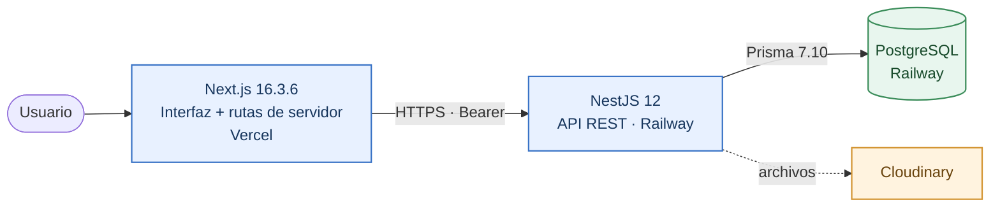
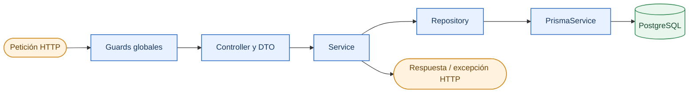

# Arquitectura del sistema

## Vista general

El usuario accede al frontend Next.js en Vercel. Para solicitudes autenticadas, una ruta de servidor
lee la cookie `session` HttpOnly y llama a la API NestJS en Railway con el access token Bearer. La API
usa Prisma para acceder a PostgreSQL; Docker Compose define el entorno local. Cloudinary almacena
imágenes de publicaciones y documentos de identidad.



### Diagrama del frontend

Pendiente de agregar el diagrama específico del frontend. El frontend es una aplicación Next.js
16.3.6 desplegada en Vercel y consume la API del backend por HTTPS.

### Flujo interno del backend

Este diagrama muestra cómo una petición HTTP atraviesa las capas del backend hasta consultar la
base de datos y cómo el servicio devuelve la respuesta o el error correspondiente.



## Stack

| Capa | Tecnología | Versión |
|---|---|---|
| Frontend | Next.js | 16.3.6 (informada por el equipo) |
| Backend | NestJS | 12 (`@nestjs/core` ^12.0.1) |
| ORM | Prisma y `@prisma/client` | 7.10 (`^7.10.0`) |
| Base de datos | PostgreSQL | 18 en Docker local (`postgres:18-alpine`); Railway aloja la base de datos de producción |
| Runtime del contenedor de API | Node.js sobre Alpine Linux | Node.js 24 (`node:24-alpine`) |
| Contenedores locales | Dockerfile y Docker Compose | Configuración presente; las versiones de Docker Engine y Compose no están fijadas en el repositorio |
| Despliegue | Vercel (frontend) y Railway (API y PostgreSQL) | Gestionado por las plataformas |
| Almacenamiento de archivos | Cloudinary | Servicio externo; imágenes de bienes y documentos de identidad |

## Estructura de carpetas

```
src/
├── auth/                 # Autenticación, tokens y guards
├── bookings/             # Reservas y decisiones de depósitos
├── common/               # Utilidades compartidas
├── config/               # Configuración y validación de entorno
├── health/               # Health check
├── identity-document/    # Verificación y documentos de identidad
├── income/               # Reportes de ingresos
├── messaging/            # Conversaciones y mensajes
├── notifications/        # Notificaciones
├── payments/             # Pagos simulados e historial
├── prisma/               # Servicio y acceso a Prisma
├── profile/              # Perfil y cambio de rol
├── properties/           # Catálogo, publicaciones y disponibilidad
├── reviews/              # Reseñas y reportes de calificaciones
└── users/                # Cuentas de usuario

prisma/                   # Esquema, migraciones y seed
test/                     # Pruebas
docs/                     # Documentación del proyecto
Dockerfile                # Imagen de la API
docker-compose.yml        # API y PostgreSQL para entorno local
```

## Decisiones técnicas
## Decisiones técnicas

| Decisión | Alternativas consideradas | Motivo |
|---|---|---|
| Transacciones serializables en operaciones críticas | Bloqueos manuales con un nivel de aislamiento más bajo; o solo control de versiones | Reservas, pagos, bloqueos, cambio de rol y decisiones de depósito leen y escriben datos relacionados en una misma operación. Elegimos aislamiento serializable para que dos solicitudes simultáneas no reserven las mismas fechas ni cobren dos veces. Cuando hay conflicto, respondemos `409 DATES_UNAVAILABLE`, el mismo error que si las fechas estuvieran ocupadas. |
| JWT Bearer con access token de vida corta (15 minutos) | Sesiones guardadas en el servidor | Elegimos JWT porque el access token se valida sin consultar la base en cada petición. Lo mantuvimos corto para que un token robado sirva poco tiempo. Además es el contrato que el backend ya implementa, y el frontend lo consume así. |
| Refresh token opaco, rotado y guardado como SHA-256 | Refresh token en formato JWT; o guardarlo con bcrypt | Usamos un string aleatorio de 32 bytes, así que no necesita un hash lento como bcrypt. Elegimos SHA-256 porque permite buscar el token por un índice, algo que no se puede hacer con bcrypt porque cada hash lleva un salt distinto. Además bcrypt solo considera los primeros 72 bytes. Guardamos el hash y no el valor en claro para que una filtración de la base no entregue sesiones válidas. |
| Tokens entregados al frontend en cookie `HttpOnly` mediante Next.js | El backend emite `Set-Cookie`; o guardar el token en `localStorage` | Decidimos que el frontend guarde los tokens en una cookie `HttpOnly` desde una ruta de servidor de Next.js. Así el token no queda accesible para el JavaScript del navegador, que es el riesgo de guardarlo en `localStorage`. El backend no maneja cookies y sigue validando cada petición. |
| Protección por defecto con `JwtAuthGuard` global y `RolesGuard` | Proteger cada ruta por separado | Quisimos que una ruta nueva quede protegida aunque alguien olvide agregar el guard. Por eso todo está cerrado por defecto, solo las rutas con `@Public()` se abren, y los permisos por rol se declaran con `@Roles()` en cada endpoint. |
| Contraseñas con bcrypt (cost 12) | Argon2; o SHA-256 simple | Las contraseñas son de baja entropía, así que necesitan un algoritmo lento que dificulte los ataques por fuerza bruta. Elegimos bcrypt porque es un estándar probado y su costo se ajusta con `BCRYPT_SALT_ROUNDS`. |
| Límite de intentos de login guardado en la base, con HMAC del correo | Límite en memoria; o guardar el correo en claro | Elegimos guardar los intentos en PostgreSQL para que el límite se mantenga aunque la API tenga varias instancias o se reinicie. Aplicamos 5 intentos fallidos en 15 minutos, con bloqueo de 15 minutos. Usamos un HMAC del correo para no guardarlo en claro. Para correos que no existen también hacemos una comparación bcrypt, así la respuesta no revela si la cuenta existe. |
| `ValidationPipe` global con `whitelist` y `forbidNonWhitelisted` | Validar manualmente en cada controlador; o ignorar los campos extra | Activamos esta validación para que un cliente no pueda enviar campos que no le corresponden, como el rol o el estado de verificación. Rechazar los campos extra, en vez de ignorarlos en silencio, nos ayuda a detectar errores del frontend. Además todos los errores de validación usan el mismo formato (`VALIDATION_ERROR`). |
| Imágenes de bienes y documentos de identidad en Cloudinary | Guardar los archivos en el disco del servidor; o un bucket de almacenamiento propio | Elegimos un servicio externo para que el servidor no tenga que guardar archivos. La base solo almacena las URL HTTPS. Las imágenes de los bienes son públicas. Los documentos de identidad los subimos como recursos privados con un `public_id` aleatorio, y solo se entregan mediante enlaces temporales en una ruta de revisión, porque son datos sensibles. |
| Notificaciones con un único servicio interno (`NotificationsService.emit`) | Que cada módulo cree sus notificaciones; o exponer un endpoint HTTP | Quisimos un solo punto de entrada para que todas las notificaciones validen al destinatario y usen las plantillas de cada evento. Además, se evita exponer una ruta innecesaria y se mantiene una mejor separación de responsabilidades entre los módulos.|
| Pagos simulados, sin datos completos de tarjeta | Integrar una pasarela de pagos real | Elegimos una simulación porque el alcance del proyecto es académico y no transferimos dinero. Solo guardamos los últimos cuatro dígitos de la tarjeta, nunca el número completo, el vencimiento ni el CVC. La tarjeta que termina en `0002` representa fondos insuficientes y cuando termina en `4242` se realiza un pago éxitoso.|
| Procesos periódicos para vencer reservas y depósitos | Colas de trabajos como BullMQ; o un cron externo | Elegimos un proceso periódico dentro de la aplicación porque necesitábamos evitar que las fechas de una reserva quedaran bloqueadas indefinidamente si el arrendatario no realizaba el pago. Cuando alguien solicita una reserva, tiene 24 horas para pagar. Por eso, implementamos un proceso que revisa cada 30 segundos las reservas pendientes y, si ya venció el plazo, las cancela automáticamente y libera las fechas. Elegimos esta opción porque es sencilla y suficiente para nuestra necesidad. |
| Promedios de calificación calculados, no guardados | Guardar el promedio en una columna y actualizarlo en cada reseña | Calculamos el promedio desde las reseñas para que siempre coincida con los datos y no tengamos que mantener un campo sincronizado. Así una nueva calificación aparece en el siguiente reporte sin pasos adicionales. |
| Fechas en la zona horaria `America/El_Salvador` | Usar UTC en todo el sistema | Elegimos esta zona porque los usuarios y las reservas son de El Salvador. Así los días del calendario, los periodos de los reportes y los plazos de 24 horas y de 7 o 14 días coinciden con lo que el usuario ve. |
| Documentación con Swagger en `/api/docs` | Documentación manual en Postman | Elegimos Swagger porque se genera desde los DTO, así que la documentación cambia junto con el código. La cátedra también exige la documentación de la API en el ambiente desplegado.  |
