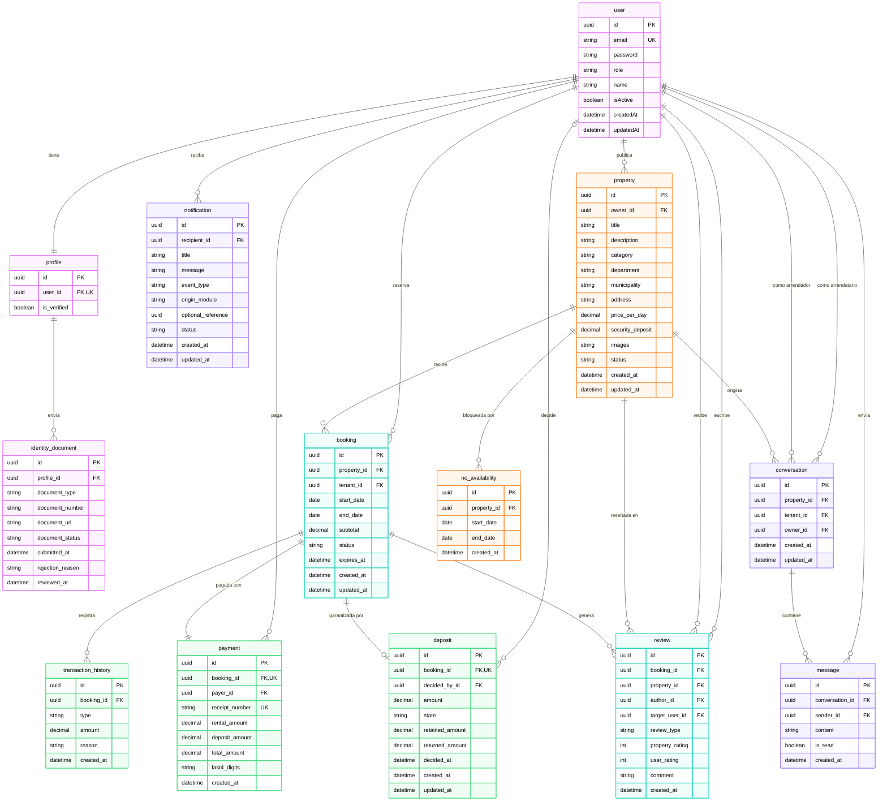

# Modelo de datos
Diagrama relacional de Runaways.

## Diagrama entidad-relación

## Descripción de las tablas

| Tabla | Descripción | Campos importantes |
|---|---|---|
| `user` | Cuenta de una persona que usa el sistema. | `name`, `email`, `password`, `role`, `isActive` |
| `profile` | Perfil de verificación asociado a una cuenta. | `user_id`, `is_verified` |
| `identity_document` | Documento de identidad enviado para verificación. | `document_type`, `document_number`, `document_url` (Cloudinary), `document_status`, `rejection_reason`, `submitted_at`, `reviewed_at` |
| `property` | Bien publicado para alquiler. | `owner_id`, `title`, `category`, `department`, `municipality`, `price_per_day`, `security_deposit`, `images` (URLs de Cloudinary), `status` |
| `no_availability` | Período en que un bien no está disponible. | `property_id`, `start_date`, `end_date` |
| `booking` | Reserva de un bien hecha por un arrendatario. | `property_id`, `tenant_id`, `start_date`, `end_date`, `subtotal`, `status`, `expires_at` |
| `payment` | Pago asociado a una reserva. | `booking_id`, `receipt_number`, `rental_amount`, `deposit_amount`, `total_amount`, `last4_digits` |
| `deposit` | Depósito de garantía asociado a una reserva. | `booking_id`, `decided_by_id`, `amount`, `state`, `retained_amount`, `returned_amount`, `decided_at` |
| `transaction_history` | Movimiento financiero registrado para una reserva. | `booking_id`, `type`, `amount`, `reason`, `created_at` |
| `review` | Calificación escrita por una de las partes de una reserva. | `booking_id`, `author_id`, `target_user_id`, `review_type`, `property_rating`, `user_rating`, `comment` |
| `conversation` | Hilo de mensajes entre el arrendatario y el arrendador de un bien. | `property_id`, `tenant_id`, `owner_id`, `created_at`, `updated_at` |
| `message` | Mensaje enviado dentro de una conversación. | `conversation_id`, `sender_id`, `content`, `is_read`, `created_at` |
| `notification` | Aviso asociado a un usuario y a un evento del sistema. | `recipient_id`, `title`, `message`, `event_type`, `origin_module`, `optional_reference`, `status` |

