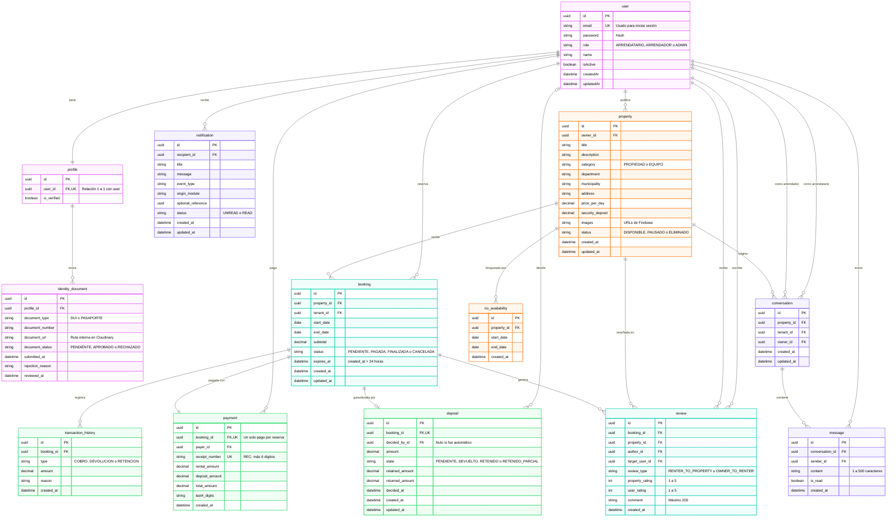

# Modelo de datos
Diagrama relacional de Runaways.

## Diagrama entidad-relación

## Descripción de las tablas

| Tabla | Descripción |
|---|---|
| `user` | Credenciales y control de acceso de la cuenta: correo único, hash de la contraseña, rol (`ARRENDATARIO`, `ARRENDADOR` o `ADMIN`) y bandera `isActive`. Toda cuenta nueva inicia como `ARRENDATARIO`. |
| `profile` | Perfil asociado de forma 1 a 1 a cada `user`. Guarda si la cuenta está verificada (`is_verified`), dato que consultan las reservas y los pagos (H21). |
| `identity_document` | Documento de identidad enviado para verificación: tipo (DUI o pasaporte), número, ruta privada del archivo en Firebase Storage, estado de revisión, motivo de rechazo y fecha de revisión por un `ADMIN`. |
| `property` | Bien publicado por un arrendador: título, descripción, categoría, ubicación, precio por día, depósito de garantía, fotos y estado (`DISPONIBLE`, `PAUSADO` o `ELIMINADO`). El borrado es lógico. |
| `no_availability` | Bloqueos de fechas que un arrendador registra sobre su bien. Se eliminan físicamente y cuentan como días ocupados junto con las reservas `PENDIENTE` y `PAGADA`. |
| `booking` | Reservación de un bien por un arrendatario en un rango de fechas. Nace `PENDIENTE` y vence a las 24 horas (`expires_at`) si no se paga. Nunca se borra: se cancela. |
| `payment` | Pago simulado de una reserva. Solo existe uno por reserva (`booking_id` único). Separa el monto del alquiler, el del depósito y el total, y guarda únicamente los últimos 4 dígitos de la tarjeta. |
| `deposit` | Depósito de garantía de una reserva. Solo se crea si el depósito del bien es mayor a 0. Registra el estado (`PENDIENTE`, `DEVUELTO`, `RETENIDO` o `RETENIDO_PARCIAL`) y los montos retenido y devuelto. `decided_by_id` es nulo cuando la devolución fue automática. |
| `transaction_history` | Historial de movimientos financieros de una reserva (`COBRO`, `DEVOLUCION`, `RETENCION`). Los registros no se eliminan. |
| `review` | Reseña de una reserva finalizada. `RENTER_TO_PROPERTY` califica el bien y al arrendador; `OWNER_TO_RENTER` califica al arrendatario. Los promedios se calculan a partir de esta tabla y no se guardan. |
| `conversation` | Hilo de conversación entre un arrendatario y el arrendador de un bien. Solo esas dos partes pueden verlo. |
| `message` | Mensaje de un hilo, de 1 a 500 caracteres, con indicador de lectura. |
| `notification` | Aviso dirigido a un usuario, creado por el servicio común de notificaciones. Guarda el módulo de origen, el tipo de evento, una referencia opcional al registro relacionado y su estado (`UNREAD` o `READ`). |

