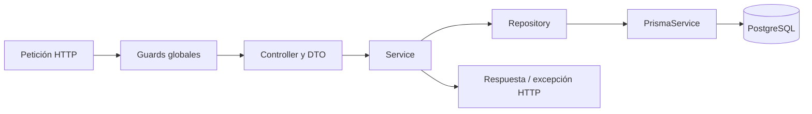

# Arquitectura del backend

Este documento describe la organización implementada actualmente en el backend NestJS. Los módulos
de producto que todavía no tienen controlador o servicio en `src/` se consideran pendientes de
implementación, aunque sus contratos aparezcan en `AGENTS.md`.

## Capas

- **Controller:** conecta HTTP con el módulo. Recibe DTOs validados, obtiene la identidad de la
  sesión cuando aplica y delega en el servicio.
- **Service:** contiene la lógica de negocio, coordina servicios y repositorios y decide los
  resultados o errores del caso de uso.
- **Repository:** encapsula consultas, escrituras y transacciones de Prisma. No debe decidir reglas
  de producto como permisos o elegibilidad.
- **DTO:** define la forma de entrada o salida y, cuando corresponde, validaciones y documentación
  Swagger.

## Módulos actuales

| Módulo | Responsabilidad |
|---|---|
| `auth` | Registro, login, emisión y rotación de tokens, intentos de login y guards de autenticación/autorización. |
| `users` | Creación, consulta y actualización de cuentas; `UserRepository` encapsula Prisma. |
| `profile` | Cambio del rol entre `TENANT` y `OWNER`. |
| `properties` | Creación de bienes por propietarios, validación de imágenes y carga a Cloudinary. Consulta paginada del catálogo de bienes disponibles mediante controlador, servicio y repositorio. |
| `health` | Health check público. |
| `prisma` | Configura y exporta el cliente Prisma para los repositorios. |
| `common` | Utilidades y decoradores compartidos. |
| `config` | Validación y tipos de configuración de entorno. |

`AppModule` registra `JwtAuthGuard` como guard global, seguido de `RolesGuard`. Por eso las rutas
requieren autenticación por defecto y se marcan con `@Public()` cuando deben quedar exentas del
guard JWT. Las rutas con restricción de rol declaran `@Roles(...)`.

## Ejemplos de flujo entre capas

- Login: `AuthController` → `AuthService` → `UsersService`, `LoginRateLimitService` y `TokenService`;
  los repositorios de usuarios, intentos y refresh tokens acceden a PostgreSQL mediante Prisma.
- Cambio de rol: `ProfileController` → `ProfileRoleService` → `ProfileRoleRepository` y
  `TokenService`. El servicio aplica las reglas; el repositorio agrupa las lecturas y escrituras de
  base de datos en una transacción serializable.
- Publicación: `PropertiesController` recibe los campos y archivos multipart, `PropertiesService`
  valida las imágenes y coordina su carga a `CloudinaryService`; `PropertyRepository` guarda el bien
  y las URLs seguras en PostgreSQL. Si falla la persistencia, elimina las imágenes cargadas durante
  esa solicitud.

## Validación y documentación HTTP

El `ValidationPipe` global transforma los DTOs, rechaza propiedades desconocidas y devuelve
`400 VALIDATION_ERROR` cuando la entrada no cumple sus reglas. Swagger se publica en `/api/docs`.

## Documentos relacionados

- [Modelo de datos](./modelo-datos.md)
- [Endpoints](./endpoints.md)
- [Flujos de autenticación](./flujos-autenticacion.md)
- [Decisiones técnicas](./decisiones-tecnicas.md)
