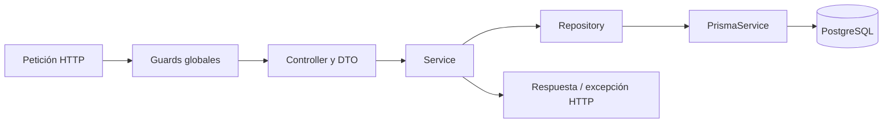

# Arquitectura del backend

Este documento describe la organización implementada actualmente en el backend NestJS. Los módulos
de producto que todavía no tienen controlador o servicio en `src/` se consideran pendientes de
implementación, aunque sus contratos aparezcan en `AGENTS.md`.

## Capas

- **Controller:** conecta HTTP con el módulo. Recibe DTOs validados, obtiene la identidad de la
  sesión cuando aplica y delega en el servicio.
- **Service:** contiene la lógica de negocio, coordina servicios y repositorios y decide los
  resultados o errores del caso de uso.
- **Repository:** encapsula consultas, escrituras y transacciones de Prisma. No debe decidir reglas
  de producto como permisos o elegibilidad.
- **DTO:** define la forma de entrada o salida y, cuando corresponde, validaciones y documentación
  Swagger.

## Módulos actuales

| Módulo | Responsabilidad |
|---|---|
| `auth` | Registro, login, emisión y rotación de tokens, intentos de login y guards de autenticación/autorización. |
| `users` | Creación, consulta y actualización de cuentas; `UserRepository` encapsula Prisma. |
| `profile` | Consulta del perfil propio, documento de identidad y calificación según rol vigente; cambio del rol entre `TENANT` y `OWNER`. |
| `identity-document` | Lógica, persistencia y almacenamiento privado de documentos de identidad. `ProfileController` expone el envío y consulta propia, y rutas administrativas para listar, abrir y revisar documentos bajo `/profile/document/admin`. Cloudinary genera enlaces temporales para los archivos privados. |
| `properties` | Creación y gestión de publicaciones por propietarios, validación de imágenes y carga a Cloudinary. Consulta paginada del catálogo, detalle y disponibilidad de bienes disponibles. La consulta de disponibilidad combina las fechas de reservas activas con bloqueos del arrendador sin exponer participantes. El servicio aplica propiedad, bloqueos por reservas y borrado lógico en transacciones serializables.Creación, listado y eliminación de bloqueos mediante `AvailabilityBlocksController`, DTOs, `PropertiesService` y `PropertiesRepository`. |
| `bookings` | Creación de reservas pendientes, validación de disponibilidad y verificación obligatoria del perfil del TENANT autenticado para cualquier bien, consultas privadas para arrendatarios y arrendadores, y cancelación de reservas vencidas. Emite notificaciones de solicitud y vencimiento mediante `NotificationsService`. |
| `payments` | presenta el detalle de cobros de una reserva, simula el pago, marca la reserva como pagada, crea el depósito e historial de movimientos, y permite consultar ese historial a los participantes. `PaymentsService` concentra las reglas; `PaymentsRepository` coordina persistencia en transacciones serializables y reutiliza `Payment` del esquema H24. |
| `messaging` | Inicia o recupera conversaciones entre el arrendatario y el propietario de un bien, lista hilos y mensajes, marca como leídos los mensajes entrantes al consultar el hilo y emite notificaciones mediante `NotificationsService`. `MessagingService` controla la participación y el auto-envío; `MessagingRepository` encapsula consultas y escrituras Prisma. |
| `reviews` | Publica calificaciones entre las partes de una reserva completada. `ReviewsService` valida titularidad, estado, plazo y duplicados; `ReviewsRepository` persiste las reseñas y consulta promedios. Las calificaciones de arrendatarios se agregan al perfil y a las reservas que consulta el arrendador. |
| `income` | Consulta agregada del ingreso del `OWNER` autenticado mediante `GET /income/reports` y `GET /income/reports/by-property`, calculando alquileres desde pagos y depósitos retenidos desde las decisiones registradas. |
| `notifications` | Servicio interno unificado para emitir avisos y API autenticada para consultar la bandeja, el contador de no leídas y marcar notificaciones propias como leídas. El destinatario de cada consulta se obtiene de la sesión. |
| `health` | Health check público. |
| `prisma` | Configura y exporta el cliente Prisma para los repositorios. |
| `common` | Utilidades y decoradores compartidos. |
| `config` | Validación y tipos de configuración de entorno. |

`AppModule` registra `JwtAuthGuard` como guard global, seguido de `RolesGuard`. Por eso las rutas
requieren autenticación por defecto y se marcan con `@Public()` cuando deben quedar exentas del
guard JWT. Las rutas con restricción de rol declaran `@Roles(...)`.

## Ejemplos de flujo entre capas

- Login: `AuthController` → `AuthService` → `UsersService`, `LoginRateLimitService` y `TokenService`;
  los repositorios de usuarios, intentos y refresh tokens acceden a PostgreSQL mediante Prisma.
- Cambio de rol: `ProfileController` → `ProfileRoleService` → `ProfileRoleRepository` y
  `TokenService`. El servicio aplica las reglas; el repositorio agrupa las lecturas y escrituras de
  base de datos en una transacción serializable.
- Documento de identidad: `ProfileController` recibe `/profile/document` y delega a
  `IdentityDocumentService`; ese servicio valida las reglas y coordina `IdentityDocumentRepository`
  con `IdentityDocumentCloudinaryService`. El repositorio limita su responsabilidad a persistencia y
  transacciones.
- Publicación: `PropertiesController` recibe los campos y archivos multipart, `PropertiesService`
  valida las imágenes y coordina su carga a `CloudinaryService`; `PropertiesRepository` guarda el bien
  y las URLs seguras en PostgreSQL. Si falla la persistencia, elimina las imágenes cargadas durante
  esa solicitud.
- Reserva: `BookingsController` obtiene el arrendatario de la sesión y delega a `BookingsService`.
  El servicio valida el periodo y la verificación de cuenta; `BookingsRepository` comprueba reservas y
  bloqueos y crea la reserva en una transacción serializable. Después solicita el aviso al arrendador
  mediante `NotificationsService`. El servicio de reservas también procesa periódicamente reservas
  `PENDING` cuyo plazo de pago venció, las cambia a `CANCELED` y solicita avisos a ambas partes.
- Pago: `PaymentsController` obtiene el TENANT de la sesión y delega a `PaymentsService`. El servicio
  valida la reserva y que el perfil del TENANT autenticado esté verificado, calcula alquiler más depósito con montos guardados, y coordina
  `PaymentsRepository` para registrar `Payment`, depósito, movimiento y estado `PAID` en una
  transacción serializable. Después solicita la notificación al OWNER; no realiza transferencias reales.
- Decisión del depósito: `BookingsController` obtiene el OWNER de la sesión y delega a
  `DepositDecisionsService`; el servicio valida propiedad, estado finalizado y montos, y registra la
  decisión y movimientos mediante `DepositsRepository` en una transacción serializable. El proceso
  periódico devuelve automáticamente depósitos pendientes siete días después de que la reserva pasa
  a `COMPLETED`, y notifica al arrendatario.
- Mensajería: `ConversationsController` recibe peticiones autenticadas y delega a `MessagingService`.
  El servicio limita el acceso a tenant y propietario del bien, coordina `MessagingRepository` para
  persistir los hilos y mensajes, y solicita una notificación al otro participante por cada mensaje.
  Al consultar mensajes, el repositorio marca como leídos únicamente los mensajes recibidos por quien
  consulta.
- Calificación: `ReviewsController` obtiene el TENANT de la sesión y delega a `ReviewsService`; el
  servicio valida la reserva finalizada y su ventana de 14 días y `ReviewsRepository` guarda la reseña
  en una transacción serializable. Los detalles de bien y perfil calculan los promedios desde estas
  reseñas, por lo que reflejan la publicación sin almacenamiento duplicado.
- Calificación del arrendatario: el OWNER de la reserva usa `ReviewsController` y `ReviewsService`;
  el repositorio valida que sea dueño del bien, guarda la reseña `OWNER_TO_RENTER` y devuelve el
  detalle con el promedio actualizado del TENANT. El perfil y las reservas del arrendador consultan
  esas mismas reseñas agregadas.

## Validación y documentación HTTP

El `ValidationPipe` global transforma los DTOs, rechaza propiedades desconocidas y devuelve
`400 VALIDATION_ERROR` cuando la entrada no cumple sus reglas. Swagger se publica en `/api/docs`.

## Documentos relacionados

- [Modelo de datos](./modelo-datos.md)
- [Endpoints](./endpoints.md)
- [Flujos de autenticación](./flujos-autenticacion.md)
- [Decisiones técnicas](./decisiones-tecnicas.md)
