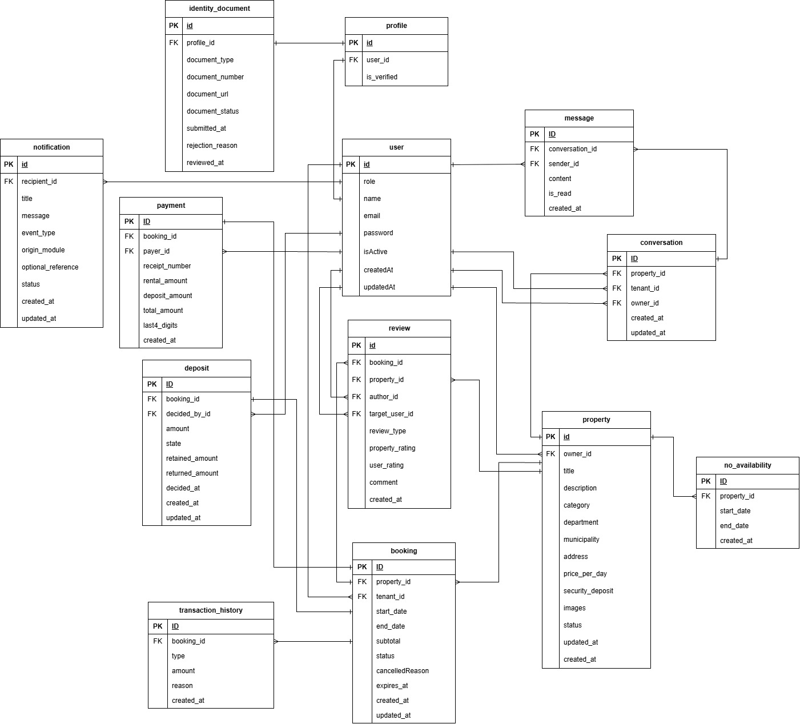

# Modelo de datos

La fuente del esquema es [`prisma/schema.prisma`](../prisma/schema.prisma). Este documento resume
los modelos que existen actualmente en ese esquema; los modelos mencionados en historias pero aún
no añadidos a Prisma se consideran pendientes.

## Diagrama

Diagrama conceptual de la base de datos del equipo:

## Entidades actuales

| Entidad | Descripción y campos principales |
|---|---|
| `User` | Cuenta con `id` UUID, `role`, `name`, `email` único, `passwordHash`, `isActive`, `createdAt` y `updatedAt`. |
| `Profile` | Perfil con `id`, `userId` único y `isVerified`. La relación permite que User no tenga perfil; el registro sí crea uno junto a la cuenta. |
| `RefreshToken` | Sesión renovable. Guarda `tokenHash` único, `userId`, `expiresAt`, `revokedAt` y `createdAt`; nunca almacena el refresh token en claro. |
| `LoginAttempt` | Contador por identificador HMAC (`keyHash`), con `attempts`, inicio de ventana, vencimiento y `lockedUntil`. No guarda el correo en claro. |
| `Property` | Bien de un `owner` con título, descripción, categoría, ubicación, precio, depósito, arreglo `images` y estado. `images` es `String[]` para almacenar URLs o referencias de Firebase. |
| `Booking` | Reserva una propiedad por un `tenant`, con fechas, subtotal, estado y fecha de expiración. |
| `Deposit` | Depósito asociado de forma 1 a 1 con una reserva; puede tener un `decidedBy` opcional y guarda monto, estado, montos devuelto/retenido y fechas de decisión. |

## Enums actuales

- `Role`: `TENANT`, `OWNER`, `ADMIN`.
- `PropertyCategory`: `PROPERTY`, `EQUIPMENT`.
- `PropertyStatus`: `AVAILABLE`, `PAUSED`, `DELETED`.
- `BookingStatus`: `PENDING`, `PAID`, `COMPLETED`, `CANCELED`.
- `DepositStatus`: `PENDING`, `RETURNED`, `RETAINED`, `PARTIALLY_RETAINED`.
