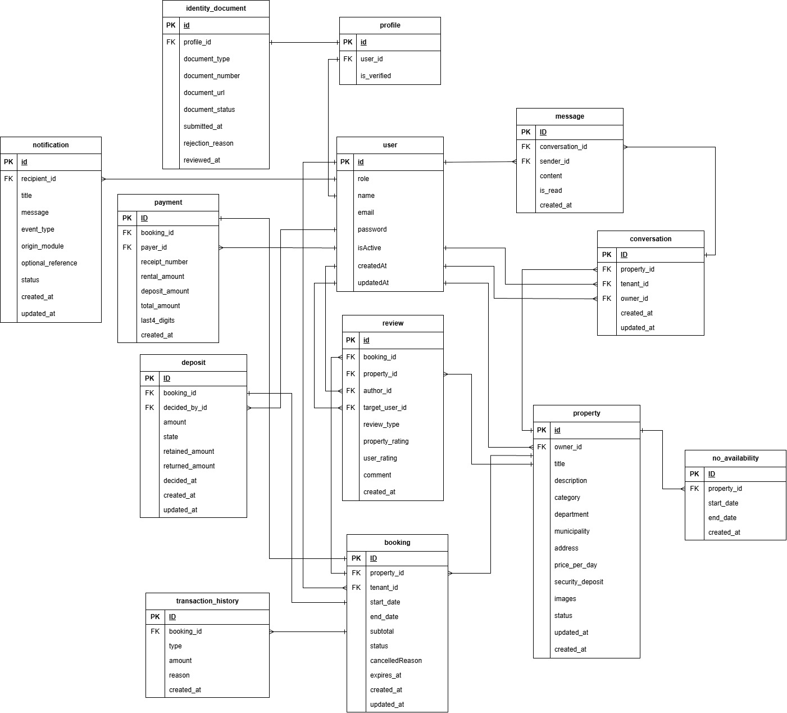

# Modelo de datos

La fuente del esquema es [`prisma/schema.prisma`](../prisma/schema.prisma). Este documento resume
los modelos que existen actualmente en ese esquema; los modelos mencionados en historias pero aún
no añadidos a Prisma se consideran pendientes.

## Diagrama

Diagrama conceptual de la base de datos del equipo:

## Entidades actuales

| Entidad | Descripción y campos principales |
|---|---|
| `User` | Cuenta con `id` UUID, `role`, `name`, email único, `passwordHash`, `isActive`, `createdAt` y `updatedAt`. |
| `Profile` | Perfil con `id`, `userId` único y `isVerified`. El registro crea el perfil junto a la cuenta. |
| `IdentityDocument` | Tabla `identity_document`, relacionada 1:1 con `Profile`: `documentType`, `documentNumber`, `documentUrl`, `documentStatus`, `submittedAt`, `rejectionReason` y `reviewedAt`. `documentUrl` guarda la URL HTTPS del recurso autenticado de Cloudinary; no se incluye en la respuesta de estado. |
| `RefreshToken` | Sesión renovable. Guarda `tokenHash` único, `userId`, `expiresAt`, `revokedAt` y `createdAt`; nunca almacena el refresh token en claro. |
| `LoginAttempt` | Contador por identificador HMAC (`keyHash`), con `attempts`, inicio de ventana, vencimiento y `lockedUntil`. No guarda el correo en claro. |
| `Property` | Bien de un `owner` con título (máximo 100 caracteres), descripción, categoría, ubicación, precio, depósito, `verifiedOnly`, arreglo `images` y estado. Se requiere verificación para todos los bienes y el backend fija `verifiedOnly` en `true`; el arrendador no puede configurarlo. `images` es `String[]` con URLs seguras de Cloudinary. |
| `Booking` | Reserva un bien por un `tenant`, con periodo inclusivo, subtotal calculado desde `Property.pricePerDay`, estado y `expiresAt`. Una reserva nueva queda `PENDING`; al vencer sin pago pasa a `CANCELED` y deja de ocupar las fechas. |
| `Payment` | Pago asociado 1 a 1 con una reserva y vinculado al `payer`. Conserva recibo único, `rentalAmount`, `depositAmount`, `totalAmount`, últimos cuatro dígitos y fecha de pago; no almacena número de tarjeta ni CVC. |
| `TransactionHistory` | Movimiento asociado a una reserva, con tipo, monto, motivo, actor opcional y fecha. `CHARGE`, `REFUND` y `RETENTION` se muestran como `COBRO`, `DEVOLUCION` y `RETENCION` en la API. |
| `Deposit` | Depósito asociado 1 a 1 con una reserva; puede tener un `decidedBy` opcional y guarda monto, estado, montos devuelto/retenido y fechas de decisión. Se limita la decisión al propietario de la reserva `COMPLETED` y garantiza que las partes retenida y devuelta sumen el monto original. |
| `Review` | Reseña asociada a una reserva (`reservationId` referencia `Booking.id`), un bien, autor y usuario objetivo. Solo se admite una reseña de cada tipo por reserva mediante la clave única `(reservationId, reviewType)`. `RENTER_TO_PROPERTY` requiere `propertyRating`; `OWNER_TO_RENTER` no la usa. `userRating` siempre es obligatorio y en `OWNER_TO_RENTER` califica al arrendatario. Ambas puntuaciones van de 1 a 5 y `comment` admite hasta 200 caracteres. Los promedios de bienes y usuarios se agregan desde las reseñas. |
| `Notification` | Aviso dirigido a un usuario con evento, módulo de origen, título (máximo 100), mensaje (máximo 250), referencia UUID opcional, estado `UNREAD`/`READ` y marcas de tiempo. |
| `Conversation` | Hilo único por combinación de `propertyId` y `tenantId`, asociado al bien y al arrendatario. `updatedAt` permite ordenar los hilos por actividad reciente. |
| `Message` | Mensaje de texto de hasta 500 caracteres asociado a una conversación y a su remitente. `isRead` permite contar mensajes entrantes pendientes; `createdAt` conserva la fecha y hora de envío. |

## Bloqueos de disponibilidad

H12 crea y administra estos periodos con `id`, `propertyId`, `startDate`, `endDate` y `createdAt`.
Los días son inclusivos, y solo el arrendador propietario puede crearlos o eliminarlos. El listado
incluye bloqueos cuyo fin es hoy o posterior y los ordena por fecha de inicio; los bloqueos también forman parte de `occupiedDates` del calendario.

`NoAvailability` registra los periodos que el arrendador bloquea para una propiedad. El catálogo y el calendario los consideran junto con las reservas `PAID` y `PENDING`; la respuesta de disponibilidad solo expone los días ocupados, nunca la identidad del arrendatario.

La tasa de ocupación se deriva de `Booking` para los bienes del OWNER. Cuenta días únicos de reservas `PAID` o `COMPLETED` dentro del rango inclusivo; no cuenta reservas `PENDING` o `CANCELED` ni registros `NoAvailability`. No se almacena una tasa precalculada.

## Enums actuales

- `Role`: `TENANT`, `OWNER`, `ADMIN`.
- `PropertyCategory`: `PROPERTY`, `EQUIPMENT`.
- `PropertyStatus`: `AVAILABLE`, `PAUSED`, `DELETED`.
- `BookingStatus`: `PENDING`, `PAID`, `COMPLETED`, `CANCELED`.
- `DepositStatus`: `PENDING`, `RETURNED`, `RETAINED`, `PARTIALLY_RETAINED`.
- `TransactionType`: `CHARGE`, `REFUND`, `RETENTION` (la API los muestra como `COBRO`, `DEVOLUCION`, `RETENCION`).
- `ReviewType`: `RENTER_TO_PROPERTY`, `OWNER_TO_RENTER`.
- `IdentityDocumentType`: `DUI`, `PASSPORT`.
- `IdentityDocumentStatus`: `PENDING`, `APPROVED`, `REJECTED`.
- `AccountStatus`: `UNVERIFIED`, `PENDING`, `VERIFIED`, `REJECTED` (estado calculado que devuelve la consulta del perfil).
- `NotificationStatus`: `UNREAD`, `READ`.
- `OriginModule`: `RESERVATIONS`, `PAYMENTS`, `MESSAGING`, `VERIFICATION`.
- `NotificationEventType`: `RESERVATION_CREATED`, `PAYMENT_CONFIRMED`, `RESERVATION_CANCELED_EXPIRED`, `RESERVATION_FINISHED`, `MESSAGE_NEW`, `DEPOSIT_RETURNED`, `DEPOSIT_RETURNED_AUTO`, `DEPOSIT_RETAINED`, `DOCUMENT_APPROVED`, `DOCUMENT_REJECTED`.
